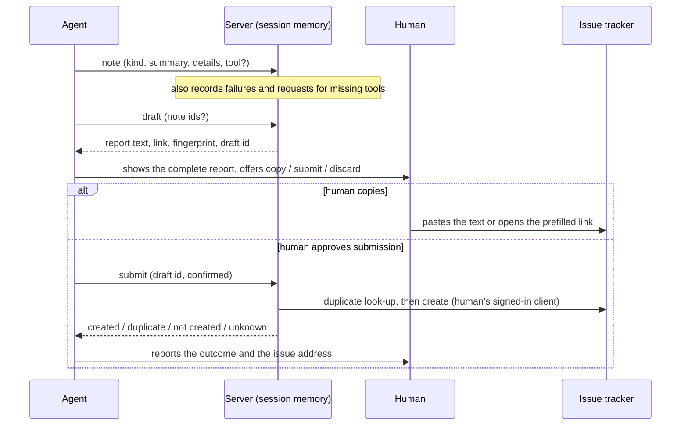

# Agent Feedback Channel

**Version:** 1.1.0
**Status:** Stable
**Layer:** concept

## Overview

Defines how an AI agent working through godot-mcp tells the project's maintainers what it found missing, broken or misleading. The agent records observations while it works, turns selected observations into one formatted report, and hands the report to the human, who either files it by hand from the text or approves its submission to the project's public issue tracker by the agent. Nothing leaves the machine without that approval.

## Related Specifications

- [l1-tool-catalog.md](l1-tool-catalog.md) - The channel's tools are catalog tools and follow its schema and hint rules (TL-1, TL-7).
- [l1-mcp-server.md](l1-mcp-server.md) - The session the channel lives in: error contract (MCP-5), pristine protocol channel (MCP-1), forgiving configuration (MCP-7).
- [l1-editor-bridge.md](l1-editor-bridge.md) - Source of the engine version and bridge state quoted in a report; its shared secret must never reach one (BR-2).
- [l1-content-authoring.md](l1-content-authoring.md) and [l1-runtime-observability.md](l1-runtime-observability.md) - Planned tools; requests for them that reach the server as unknown tool names are the demand signal this channel carries to the maintainers.
- [l2-agent-feedback-rust.md](l2-agent-feedback-rust.md) - Implementation of this concept.

## 1. Motivation

The agent is the product's primary user: it is the first to learn that a tool is missing, that an error message gave no way forward, or that a schema misled it. Today that knowledge dies with the conversation. The server answers a call to an unknown tool with an error and keeps no record of it (see `[SESSION]`), and long agent sessions are compacted, which discards what the agent noticed earlier. Maintainers hear about a gap only when a human thinks to write it up.

Two opposite failures must be avoided. Silence loses the signal. An agent that files issues on its own publishes text shaped by whatever it has read (a scene, a script, a web page) under the human's identity in a public place, and many users' agents would report the same gap again and again. The channel therefore keeps observations local, makes the report reviewable as plain text, and leaves the decision to publish with the human.

## 2. Constraints & Assumptions

- The destination is the project's public issue tracker on GitHub. Its address is derived from the package manifest, so the repository is named in exactly one place.
- The server stores no credentials. When submission is offered, it uses the human's own signed-in command-line client of the tracker.
- State lives in memory for the life of the server process, which is one MCP session. A new session starts empty.
- Reports are written in English, the language of the tracker. The conversation with the human stays in the human's language.
- GitHub facts (docs.github.com, "Creating an issue", checked 2026-10-16): a prefilled new-issue link accepts `title`, `body`, `labels`, `assignees`, `milestone`, `projects` and `template`; every parameter except title and body needs a permission the visitor may lack, and a link the visitor may not use answers 404; a link over the server limit answers 414 and the limit is not published. The prefilled link therefore carries only title and body, and the body is cut to a conservative size budget.
- Assumption (forecast): the mechanism lives in the server as tools plus session guidance, not as documentation alone, because only server-side state survives context compaction and only a tool call can be gated. Runner-up: a written convention and an issue template. Override: `/magic.spec amend l1-agent-feedback.md "documentation-only convention"`.
- Assumption (forecast): the channel is on by default, with submission available behind the human's approval, because the request is for the agent itself to be able to send the report. Runner-up: drafting only by default. Override: the `GODOT_MCP_FEEDBACK` setting.
- Assumption (forecast): one draft becomes one issue, grouped by related notes, because separate issues can be triaged and recognized as duplicates. Runner-up: one consolidated report per session. Override: `/magic.spec amend l1-agent-feedback.md "one report per session"`.

## 3. Core Invariants

Terms: a **note** is one observation the agent records; **evidence** is context the server observed itself; a **draft** is the report assembled from selected notes plus evidence; **submission** is publishing a draft to the tracker; the **human** is the person running the agent.

- **FB-1 Local until approved.** Notes, evidence and drafts exist only in the server's memory, for the life of its process. The channel writes nothing to disk and contacts no remote service except as the direct result of a submission (FB-2); the local editor and engine may be asked for their version when a draft is built. It has no background or deferred transmission.
- **FB-2 Submission is separate, explicit and bound to a draft.** Publishing is a distinct tool from drafting. It takes the identifier of a draft this server produced in this session, an explicit confirmation flag and, optionally, the request to create despite a duplicate (FB-7); it takes no text, so what is published is always exactly the draft the human was shown. Once a draft has been created as an issue, repeating the call returns that outcome instead of creating another, and two calls for the same draft at the same time cannot both create. The flag records the agent's assertion that the human approved; the human's decision itself is outside the server's reach (see section 7).
- **FB-3 Fixed destination.** The tracker is fixed by the product. No tool accepts a repository, host, address or credential.
- **FB-4 Scrubbed by construction.** Every piece of text entering a draft, whether agent-written or server-observed, is first scrubbed of: the bridge secret and anything shaped like a credential; absolute filesystem paths (the project directory, the home directory and any other absolute path become placeholders, while `res://` and `user://` paths stay); and Markdown that would notify users or make the tracker page fetch content (mentions, issue references, raw markup, embedded images). The server never gathers screenshots or the contents of project files, scenes and resources; the one project file it reads is the addon's own manifest, for its version line. Scrubbing is defence in depth: the human's review of the complete text is the actual gate, and every draft states that it will be public.
- **FB-5 Bounded.** The number of notes, the length of each note field, the number of drafts, the amount of evidence and the size of a report all have fixed limits. A note or draft over a limit is rejected with a message that names the limit and the way to proceed; evidence beyond its limit replaces the oldest.
- **FB-6 Evidence apart from opinion.** A note states what the agent tried, what happened and, optionally, what it expected or suggests. The server adds what it observed itself: failures of the tools the notes name, requests for tools that do not exist, product and engine versions, platform, bridge state and aggregate call counts. A report labels which parts the agent wrote and which the server observed.
- **FB-7 One problem per issue, duplicates not filed.** A draft covers one or more related notes and carries a fingerprint derived from stable facts (kind, named tool, observed error shape, requested-but-missing tool), not from free wording. Before creating an issue, submission looks for an issue that already carries the fingerprint; when one exists it reports that issue and creates nothing, unless the caller explicitly asks for a new issue. A failed look-up never blocks submission and is reported.
- **FB-8 A text path always exists.** In every environment (no tracker client, not signed in, offline, submission disabled) a draft yields the complete report text and, when it fits the link budget, a link that opens a prefilled new-issue page. A failed submission leaves the draft intact and retrievable within the session.
- **FB-9 Honest outcomes.** Submission reports exactly one of: created (with the issue address), duplicate found (with its address), not created (with the reason and at least one recovery step), or unknown when the client's answer cannot be understood (with the instruction to check the tracker before retrying). It never claims creation without the tracker's confirmation.
- **FB-10 Guidance in, switch out.** At session start and in the tool descriptions the server tells the agent: when to record a note and when to draft; what is not worth reporting; to write in English; to show the whole report to the human and offer copying it, submitting it or discarding it; and never to submit without the human's explicit yes. The human can turn the channel off, or down to drafting only, by configuration; off removes its tools and its guidance entirely. A setting value the server does not recognize never widens the channel: it gives drafting only and is reported on the diagnostic channel, while an empty value means the default. [MODIFIED]
- **FB-11 Never in the way.** Recording evidence changes neither the result nor the order of any other tool call and adds no noticeable delay to it. A fault inside the channel never fails another tool or the session.

## 5. Detailed Design

### 5.1 Flow



### 5.2 Tools

| Tool | Mode | Effect | Parameters |
| --- | --- | --- | --- |
| `godot_note_feedback` | host | Adds one note to session memory; answers with its id and the list of notes not yet drafted | `kind` (`bug`, `missing_feature`, `improvement`, `docs`), `summary`, `details`; optional `tool`, `impact` (`blocked`, `workaround`, `minor`), `suggestion` |
| `godot_draft_feedback` | host | Builds a draft from the chosen notes (default: every note not yet drafted) and the server's evidence; no network contact | optional `note_ids`, optional `title` |
| `godot_submit_feedback` | host, external effect | Publishes a draft to the tracker | `draft_id`, `confirmed`; optional `allow_duplicate` |

A draft may be built from notes that an earlier draft already used; the default selection is the notes not yet drafted. The draft's answer carries: the draft id, the title, the complete report text, the prefilled link (or the reason there is none), the fingerprint, which delivery paths are available now, the notes left out, and a short instruction to the agent on what to show the human next.

### 5.3 Report Layout

```plaintext
Title: [agent-feedback] {kind}: {summary}
Body:
  ## Summary                  agent-written; one bullet per note when the draft has several
  ## What happened            agent-written: what was tried and what came back
  ## Expected / suggestion    agent-written, omitted when empty
  ## Impact                   agent-written: blocked, workaround or minor
  ## Environment              server-observed: server, addon, engine, platform, bridge state, client
  ## Server-observed context  server-observed: failures of the named tools, requested-but-missing tools, call counts
  ## Report details           fingerprint, format version, notice that an agent drafted it
```

The kind of a draft with mixed kinds is the first of: `bug`, `missing_feature`, `improvement`, `docs`.

### 5.4 What the Server Gathers

| Gathered | Never gathered |
| --- | --- |
| Server version; addon version installed in the resolved project; engine version; operating system and architecture; bridge state; the MCP client's name and version | Project name; project, home or user directory names; scene, script or resource contents; node property values; screenshots |
| Per-tool call and failure counts; the scrubbed first line of recent failures of tools a note names; names of requested tools that do not exist | Environment variable values; the bridge secret; the human's tracker identity |

### 5.5 Modes

| Mode | Tools exposed | Guidance sent | Use |
| --- | --- | --- | --- |
| `full` (default) | note, draft, submit | yes | Agent may propose submission; the human decides |
| `draft` | note, draft | yes (without submission wording) | Report text only; the agent can never publish |
| `off` | none | no | The channel does not exist |

## 7. Drawbacks & Alternatives

- **Residual risk of the confirmation flag.** The flag cannot authenticate a human. A client setting that pre-approves every tool of this server also pre-approves submission, and an agent steered by hostile content could assert approval it never received. What bounds the damage: the text is scrubbed, bounded and visible in the conversation before and after, each draft publishes once, and the human can edit or delete the issue. Users who want a decision on every submission should not pre-approve the submit tool, or should use `draft` mode. The cost of the gate is one extra confirmation per published report.
- **Direct submission through the tracker's web API with a stored token**: needs credential storage, an HTTP and TLS dependency and a larger attack surface. Rejected; revisit only if the command-line path proves unusable for most users.
- **Consent through the protocol's own user-prompt request** (server asks the client to ask the human): the only channel the agent cannot answer for itself. Rejected for now because the server has no server-initiated requests and client support is uneven; it would replace the flag as the gate once supported. <!-- TBD: adopt once the supported clients declare the capability; decide then whether the flag stays as a fallback. -->
- **Saving drafts to disk**: rejected; it contradicts FB-1 and host-side writes are confined to the project (TL-4).
- **Recording every call as usage telemetry**: rejected; evidence is limited to what a note names plus missing-tool requests, and nothing proves more is needed.
- **Labels and assignees through the link or the client**: rejected; they need permissions the reporter may lack (a link answers 404, the client errors). Maintainers can label by the fingerprint and the title prefix.
- **An in-editor feedback panel**: deferred; no evidence yet that humans want to leave the chat for it.

## Canonical References

| Alias | Path | Purpose |
| --- | --- | --- |
| `[SESSION]` | `src/server.rs` | Session loop that answers unknown tool names and the initialize request |
| `[TOOLS]` | `src/tools.rs` | Catalog and dispatch the channel plugs into |
| `[MANIFEST]` | `Cargo.toml` | Repository address and version |

## Document History

| Version | Date | Author | Description |
| --- | --- | --- | --- |
| 1.0.0 | 2026-10-16 | Agent (magic.spec) | Created from the request for a mechanism that lets agents report missing features, defects and improvements to the maintainers, as copyable text or by agent submission after the human's approval. |
| 1.1.0 | 2026-10-21 | Agent (magic.spec) | [MODIFIED] FB-10: an unrecognized mode gives drafting only instead of the default (full), because a typo of a restriction (`drafts`, `of`) enabled submission. Source: simulation QA of 2026-10-21 (Q11). Stable → RFC → Stable after Post-Update Review. |
