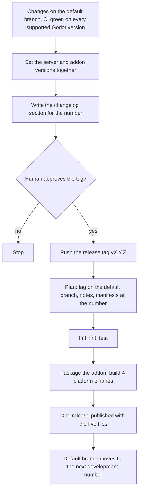

# Release & Distribution

**Version:** 1.4.0
**Status:** Stable
**Layer:** concept

## Overview

Defines how godot-mcp reaches its users: what a release contains, which platforms it covers, how the server and the editor addon stay in step, what must be true before anything is published, and what may never be committed or shipped.

## Related Specifications

- [l1-quality-assurance.md](l1-quality-assurance.md) - The verification gate every release must pass.
- [l1-release-lines.md](l1-release-lines.md) - One release, made from the default branch, serves every supported Godot version (RL-3, RL-8, RL-9).
- [l1-editor-bridge.md](l1-editor-bridge.md) - BR-10: the addon never ships inside exported games.
- [l2-ci-release-pipeline.md](l2-ci-release-pipeline.md) - Implementation of this concept.

## 1. Motivation

Users install a prebuilt binary plus an addon folder, often through an AI assistant following the README. A mismatch between the two, a release without notes, or a binary that needs a runtime the user lacks turns installation into support work. Publishing is also the one step that cannot be undone, so it must sit behind an explicit human decision.

## 2. Constraints & Assumptions

- Versioning follows Semantic Versioning; the project is pre-1.0, so minor versions may carry breaking changes, which the release notes must call out.
- A release is one build for every supported Godot version: one server archive per platform and one addon archive, none of them named for a Godot version (RL-3, RL-8, RL-9). Version numbers follow one sequence.
- Release notes live in the repository changelog, one section per version, written for users; the section text is the published release description. A note that applies to some Godot versions only says which.
- Supported platforms: Windows x86_64, Linux x86_64, macOS x86_64, macOS arm64.
- Development-time scaffolding (planning artifacts, agent engines) is not part of any shipped artifact.

## 3. Core Invariants

- **DS-1 One version.** The server and the addon always carry the same version number; a divergence fails the automated tests.
- **DS-2 Self-contained binaries.** Each supported platform gets one native executable with no runtime dependency beyond the OS (no interpreter, no VM).
- **DS-3 Gated publication.** A release is built only from a tag equal to the release number on a commit of the default branch whose manifests carry that number, only after the verification gate has passed on that commit for every supported Godot version, and only when the changelog has a non-empty section for that number.
- **DS-4 User-facing notes only.** Release notes describe behaviour changes for users. Internal process events (planning, specification or task bookkeeping) never appear in them.
- **DS-5 Separate, editor-only addon.** The addon ships as its own archive, is enabled per project, and excludes itself from game exports while enabled; the docs tell users how to exclude it when it is disabled.
- **DS-6 No machine-specific state in the repository.** Local paths, secrets and client configs with real paths are never committed; examples with placeholders are committed instead.
- **DS-7 Human confirmation before publishing.** Creating and pushing a release tag happens only after a person has seen the version and the commit and explicitly approved it.
- **DS-9 A build names its commit.** The version a running server reports adds the commit it was built from as build metadata, so builds between two releases can be told apart although the manifests change only in release commits. A build with no commit to name (no git, a source archive) reports the manifest version alone, and a commit that is not a short hexadecimal id is never put into the version.
- **DS-10 The release number follows the changes.** The number a release takes is computed from the kind of the changes since the last release, by one script, not judged anew at each release: a breaking change or a new feature moves the minor number while the project is before 1.0, anything else the patch number. The version of the default branch between releases is the next number with a development marker (`X.Y.Z-dev`), moved right after a release and whenever it has fallen behind the number the changes imply, in a commit of its own.
- **DS-8 Scaffold-free artifacts.** No shipped artifact — binary archive, addon archive, or source archive generated from a tag — contains planning or agent-engine directories.

## 5. Detailed Design

### 5.1 Release Flow

One pass from the default branch:

### 5.2 Release Assets

No file name carries a Godot version: the same files serve every supported Godot version.

| Asset | Content |
| --- | --- |
| `godot-mcp-x86_64-pc-windows-msvc.zip` | Server executable |
| `godot-mcp-x86_64-unknown-linux-gnu.tar.gz` | Server executable |
| `godot-mcp-x86_64-apple-darwin.tar.gz` | Server executable |
| `godot-mcp-aarch64-apple-darwin.tar.gz` | Server executable |
| `godot-mcp-addon.zip` | `addons/godot_mcp` only |

A release holds these five files. Releases 0.5.1 to 0.15.0 were built once per Godot version and hold those five files for each of three versions, named with `-godotM.N`; releases 0.1.0 to 0.4.0 keep their original file names. All of them stay published and are unsupported.

## 7. Drawbacks & Alternatives

- **Package managers (crates.io, Homebrew, Scoop)**: easier updates, but each adds a channel to maintain; deferred until there is demand.
- **Embedding the addon in the server binary** (the server installs it): one download, but the server would write into user projects on its own; rejected.

## Canonical References

| Alias | Path | Purpose |
| --- | --- | --- |
| `[RELEASE]` | `.github/workflows/release.yml` | Verify, package and publish on tag push |
| `[NOTES]` | `.github/scripts/release-notes.sh` | Extracts and enforces the changelog section |
| `[CHANGELOG]` | `CHANGELOG.md` | User-facing release notes |
| `[MANIFEST]` | `Cargo.toml` | Server version and release profile |
| `[ADDON]` | `addons/godot_mcp/plugin.cfg` | Addon version |
| `[VERSION]` | `src/version.rs` | The version a server reports, with its commit (DS-9) |

## Document History

| Version | Date | Author | Description |
| --- | --- | --- | --- |
| 1.0.0 | 2026-10-16 | Agent (magic.analyze first-time) | Reverse-engineered from the release workflow and the release skill at 94e4540. DS-4 and DS-8 added to keep the specification-driven workflow out of user-facing notes and source archives. |
| 1.1.0 | 2026-10-20 | Agent (magic.spec) | [ADDED] Releases per Godot release line: line in the version string, one numbering, per-line changelog; [MODIFIED] release flow per line and asset names with the line. Stable → RFC → Stable after Post-Update Review. |
| 1.2.0 | 2026-10-20 | Agent (magic.spec) | [MODIFIED] One release per number holding the files of every supported line, one changelog, release flow and DS-3 accordingly. |
| 1.3.0 | 2026-11-02 | Agent (magic.spec) | [ADDED] DS-9 (a build names its commit) and DS-10 (the release number follows the changes). Source: the maintainer's observation that the patch number never moves between releases and the minor number only at publication; the manifests changing only in release commits is kept, because identity files differ per line and a per-pull-request bump would conflict on every carry. Stable → RFC → Stable after Post-Update Review. |
| 1.3.1 | 2026-11-05 | Agent (magic.spec) | Removed the `[ADDED]` and `[MODIFIED]` markers from the body: the history rows carry what changed. No requirement changed. |
| 1.4.0 | 2026-11-20 | Agent (magic.spec) | Modified for one build serving every supported Godot version: a release is five files named without a Godot version, built once from the default branch; DS-3 gates on a default-branch commit verified on every supported version; DS-10 moves the development number in a commit of its own, with nothing to carry; flow and asset tables rewritten. DS-1 to DS-9 keep their meaning. Stable → RFC → Stable after Post-Update Review; C12 quarantine of l2-ci-release-pipeline.md applied and lifted in the same pass. |
