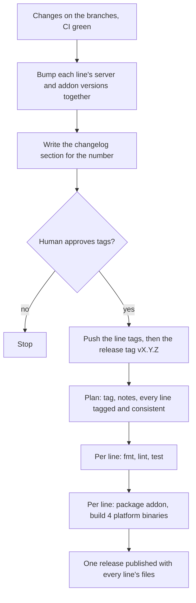

# Release & Distribution

**Version:** 1.2.0
**Status:** Stable
**Layer:** concept

## Overview

Defines how godot-mcp reaches its users: what a release contains, which platforms it covers, how the server and the editor addon stay in step, what must be true before anything is published, and what may never be committed or shipped.

## Related Specifications

- [l1-quality-assurance.md](l1-quality-assurance.md) - The verification gate every release must pass.
- [l1-release-lines.md](l1-release-lines.md) - Releases are made per Godot release line; every rule here applies to each line.
- [l1-editor-bridge.md](l1-editor-bridge.md) - BR-10: the addon never ships inside exported games.
- [l2-ci-release-pipeline.md](l2-ci-release-pipeline.md) - Implementation of this concept.

## 1. Motivation

Users install a prebuilt binary plus an addon folder, often through an AI assistant following the README. A mismatch between the two, a release without notes, or a binary that needs a runtime the user lacks turns installation into support work. Publishing is also the one step that cannot be undone, so it must sit behind an explicit human decision.

## 2. Constraints & Assumptions

- Versioning follows Semantic Versioning; the project is pre-1.0, so minor versions may carry breaking changes, which the release notes must call out.
- [MODIFIED] A release contains the files of every supported Godot release line; each file name and each line's version string name the line (RL-3, RL-8). Version numbers follow one sequence.
- Release notes live in the repository changelog, one section per version, written for users; the section text is the published release description. [MODIFIED] The release notes of all lines are one changelog.
- Supported platforms: Windows x86_64, Linux x86_64, macOS x86_64, macOS arm64.
- Development-time scaffolding (planning artifacts, agent engines) is not part of any shipped artifact.

## 3. Core Invariants

- **DS-1 One version.** The server and the addon always carry the same version number; a divergence fails the automated tests.
- **DS-2 Self-contained binaries.** Each supported platform gets one native executable with no runtime dependency beyond the OS (no interpreter, no VM).
- **DS-3 Gated publication.** A release is built only from a tag equal to the release number, only after every supported line has passed the verification gate at that number, and only when the changelog has a non-empty section for that number.
- **DS-4 User-facing notes only.** Release notes describe behaviour changes for users. Internal process events (planning, specification or task bookkeeping) never appear in them.
- **DS-5 Separate, editor-only addon.** The addon ships as its own archive, is enabled per project, and excludes itself from game exports while enabled; the docs tell users how to exclude it when it is disabled.
- **DS-6 No machine-specific state in the repository.** Local paths, secrets and client configs with real paths are never committed; examples with placeholders are committed instead.
- **DS-7 Human confirmation before publishing.** Creating and pushing a release tag happens only after a person has seen the version and the commit and explicitly approved it.
- **DS-8 Scaffold-free artifacts.** No shipped artifact — binary archive, addon archive, or source archive generated from a tag — contains planning or agent-engine directories.

## 5. Detailed Design

### 5.1 Release Flow [MODIFIED]

One pass for all supported lines (their branches, each with its own manifests; one changelog):

### 5.2 Release Assets [MODIFIED]

Every file name carries the line (`M.N`, e.g. `4.6`), so a downloaded file still says which Godot version it is for:

| Asset | Content |
| --- | --- |
| `godot-mcp-x86_64-pc-windows-msvc-godotM.N.zip` | Server executable |
| `godot-mcp-x86_64-unknown-linux-gnu-godotM.N.tar.gz` | Server executable |
| `godot-mcp-x86_64-apple-darwin-godotM.N.tar.gz` | Server executable |
| `godot-mcp-aarch64-apple-darwin-godotM.N.tar.gz` | Server executable |
| `godot-mcp-addon-godotM.N.zip` | `addons/godot_mcp` only |

A release holds these five files for each supported line. Releases 0.1.0 to 0.4.0, made before the lines existed, keep their original file names.

## 7. Drawbacks & Alternatives

- **Package managers (crates.io, Homebrew, Scoop)**: easier updates, but each adds a channel to maintain; deferred until there is demand.
- **Embedding the addon in the server binary** (the server installs it): one download, but the server would write into user projects on its own; rejected.

## Canonical References

| Alias | Path | Purpose |
| --- | --- | --- |
| `[RELEASE]` | `.github/workflows/release.yml` | Verify, package and publish on tag push |
| `[NOTES]` | `.github/scripts/release-notes.sh` | Extracts and enforces the changelog section |
| `[CHANGELOG]` | `CHANGELOG.md` | User-facing release notes |
| `[MANIFEST]` | `Cargo.toml` | Server version and release profile |
| `[ADDON]` | `addons/godot_mcp/plugin.cfg` | Addon version |

## Document History

| Version | Date | Author | Description |
| --- | --- | --- | --- |
| 1.0.0 | 2026-10-16 | Agent (magic.analyze first-time) | Reverse-engineered from the release workflow and the release skill at 94e4540. DS-4 and DS-8 added to keep the specification-driven workflow out of user-facing notes and source archives. |
| 1.1.0 | 2026-10-20 | Agent (magic.spec) | [ADDED] Releases per Godot release line: line in the version string, one numbering, per-line changelog; [MODIFIED] release flow per line and asset names with the line. Stable → RFC → Stable after Post-Update Review. |
| 1.2.0 | 2026-10-20 | Agent (magic.spec) | [MODIFIED] One release per number holding the files of every supported line, one changelog, release flow and DS-3 accordingly. |
