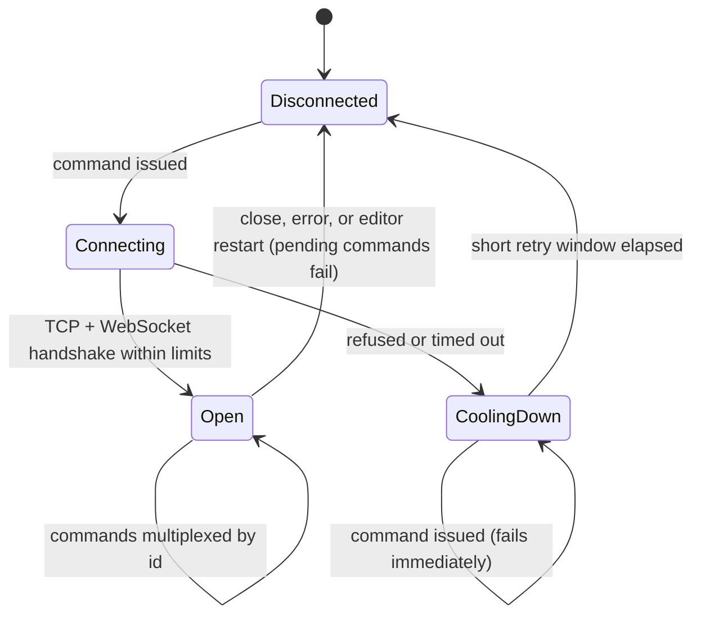
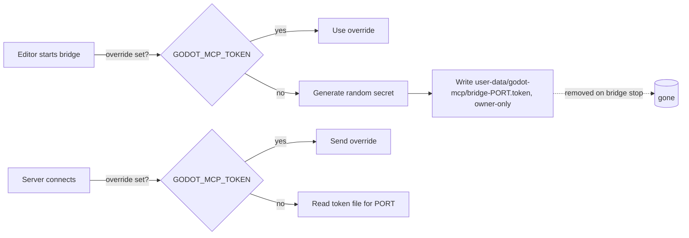

# Live Editor Bridge

**Version:** 1.1.0
**Status:** Stable
**Layer:** concept

## Overview

Defines the channel between the MCP server and a running Godot editor: who may connect, how commands and replies are framed and matched, what an editor-side mutation must guarantee to the human working in the same editor, and how the server tells "no editor" apart from "the editor said no".

## Related Specifications

- [l1-mcp-server.md](l1-mcp-server.md) - The client-facing session that issues bridge commands.
- [l1-tool-catalog.md](l1-tool-catalog.md) - Which tools need the bridge and how they fall back without it.
- [l2-bridge-client-rust.md](l2-bridge-client-rust.md) - Server-side implementation.
- [l2-godot-editor-addon.md](l2-godot-editor-addon.md) - Editor-side implementation.
- [l1-content-authoring.md](l1-content-authoring.md) - What the authoring commands of §5.2 guarantee. [ADDED]
- [l1-runtime-observability.md](l1-runtime-observability.md) - The relay to a game started by Play (`game_send`, `game_status`). [ADDED]

## 1. Motivation

The editor is a live, stateful environment shared with a human. Anything an AI agent does there must be visible and reversible with the editor's own undo, must stay inside the scene being edited, and must not be reachable by other machines or by web pages open in the developer's browser. The 2026-10-14 simulation QA found the first bridge reachable from the LAN and from cross-origin browser pages, able to escape the edited scene, and able to silently drop property updates; this specification records the guarantees that closed those holes.

## 2. Constraints & Assumptions

- Transport: WebSocket over TCP on one port per editor (BR-13). [MODIFIED]
- Minimum editor version: Godot 4.5. Older editors refuse to start the bridge.
- The server and the editor normally run as the same OS user and share the user data directory. Containers, sandboxed packages and multi-user setups use an explicit shared secret instead.
- The editor processes commands on its main thread; a long command (re-import, viewport capture) delays the next one.
- Port selection, first match wins. [MODIFIED] Editor side: the project setting `godot_mcp/bridge_port`, the editor's `GODOT_DEBUG_PORT` environment variable, the port derived from its project path (BR-13). Server side: the `--debug-port` option, `GODOT_DEBUG_PORT`, the port derived from the project found from the server's working directory, and the legacy port `9333` when no project is found. An editor the server launches gets the server's port as `GODOT_DEBUG_PORT`.

## 3. Core Invariants

- **BR-1 Loopback only.** The editor side listens on the loopback interface exclusively; no configuration exposes it to other hosts.
- **BR-2 Shared secret on every command.** Each command carries a secret that the editor generates per session and port and publishes in a per-user location readable only by its owner. An explicit override value, set identically for both processes, replaces the published secret. A missing or wrong secret yields an explicit "unauthorized" error naming the recovery steps; no code path skips the check.
- **BR-3 Exactly one reply per command.** Every command — including malformed JSON, wrongly typed parameters, unknown command types, and replies too large to send — receives one reply, success or error. Parameters are validated before a handler runs so a type mismatch can never abort the handler without a reply.
- **BR-4 Correlated, multiplexed commands.** Each command carries a unique id; replies are matched by id, so many commands can be in flight on one connection and a late reply can never be delivered to the wrong caller.
- **BR-5 Undoable mutations.** Every editor mutation (add, remove, set properties) is recorded as a single action in the editor's undo history, and undo restores the previous state exactly — including node order and ownership of the removed subtree. [MODIFIED] The same holds for script and shader edits and InputMap changes. File operations — saving, reimporting, deleting — are not undo actions; a deletion moves the files to the system trash unless the caller declines (CA-17 of [l1-content-authoring.md](l1-content-authoring.md)).
- **BR-6 Scene confinement.** Node paths are relative to the edited scene root and resolve only to nodes inside that scene; a path that leaves it is "not found". The scene root cannot be removed.
- **BR-7 All-or-nothing property updates.** A property update either applies every requested value or none. Values are converted to the target property's type; unknown properties and unconvertible values reject the whole call. The reply reports the values read back after applying. [MODIFIED] A value the property does not keep (its setter stored another one, as an audio bus the editor does not know reads back as `Master`) also rejects the whole call, naming the property and both values, and leaves nothing changed; floating-point values compare approximately, and a node name, which Godot adjusts on purpose, is not compared.
- **BR-8 Fast, classified failures.** An unreachable editor is detected in well under a second and reported as "bridge unavailable"; a broken or stalled connection is reported as a connection error; an editor that answered with an error is reported with its own message. These three classes are never conflated. After an editor restart the next command reconnects without operator action.
- **BR-9 Version gate.** On an editor older than the minimum supported version the bridge does not start and says why.
- **BR-10 Editor-only.** The bridge and everything shipped with it are excluded from exported games, in debug and release builds.
- **BR-11 Project-confined paths.** File paths accepted by editor-side commands resolve to `res://` paths inside the project; absolute paths inside the project are converted, anything else (including parent segments) is rejected.
- **BR-12 Saved edits only.** [ADDED] An edit Godot would not save — a change to a node inside an instanced scene whose children are not editable — is refused with the instance and its scene named, unless the caller asks to make that instance's children editable, which then joins the same undoable action. A node an instanced scene brings cannot be removed.
- **BR-13 One port per project.** [ADDED] Without a configured port, the editor and the server derive the port from the project's canonical path with the same function, into a range below the ephemeral ports of every supported system that does not contain the legacy port. Editors of different projects (git worktrees of one repository included) therefore never compete for one port, and a server started in a project's directory reaches that project's editor. Both implementations are checked against one shared set of path-to-port cases. While the legacy port is free, an editor on a derived port also listens there, with a secret published for that port, for servers set up before ports were derived.

## 5. Detailed Design

### 5.1 Envelope

| Direction | Fields |
| --- | --- |
| Server → editor | `commandId` (unique string), `type` (command name), `params` (object), `token` (shared secret) |
| Editor → server | `commandId` (echoed), `status` (`success` or `error`), `result` (object, on success), `error` (text, on error) |

### 5.2 Command Set

| Command | Mutates | Notes |
| --- | --- | --- |
| `ping` | no | Liveness check |
| `get_version` | no | Engine version components |
| `get_project_info` | no | Name, main scene, features, absolute project directory |
| `get_open_scenes` | no | Open scene tabs and the active one |
| `get_scene_tree` | no | Active scene, or another open tab by `scene_path` |
| `get_node_properties` | no | Editor-visible properties as type + Godot text value (long values truncated) |
| `open_scene` | editor state | Opens a scene tab and makes it the active one, also when it reloads an open tab from disk [MODIFIED] |
| `save_scene` | disk | Saves the active scene through the editor |
| `add_node` | scene (undoable) | Native classes and global script classes deriving from Node |
| `remove_node` | scene (undoable) | Restores order and ownership on undo |
| `set_node_properties` | scene (undoable) | All-or-nothing, typed conversion, read-back |
| `capture_viewport` | editor state | Switches the main screen to 2D/3D, forces a draw, returns PNG; refuses headless editors and tiny viewports |
| `run_project` / `stop_project` / `get_run_status` | play state | Editor Play mode |
| `resave_resources` | editor file system | Importable assets re-imported synchronously, other files refreshed, a loaded resource or script reloaded in place [MODIFIED]; no paths means a background full rescan |
| `create_scene`, `create_resource` | disk | A new scene or resource file; never replaces one [ADDED] |
| `attach_script`, `connect_signal` | scene (undoable) | Attach or detach a script; a persistent signal connection [ADDED] |
| `list_signals`, `get_project_settings` | no | Signals of a node and their connections; project settings [ADDED] |
| `set_project_setting` | disk | One scalar setting, its type kept [ADDED] |
| `read_script`, `edit_script` | no / disk (undoable) | A script as the editor would save it; one fragment replaced [ADDED] |
| `script_tab` | editor state | Whether a script has a tab with unsaved changes; reloads an unchanged tab that shows an older text [ADDED] |
| `create_shader`, `read_shader`, `edit_shader` | disk (an edit is undoable) | Text shaders through the shader editor and the shader in memory [ADDED] |
| `get_input_map`, `edit_input_action` | no / disk (undoable) | InputMap actions and their events [ADDED] |
| `delete_files` | disk, editor file system | Project files with their companions, as the FileSystem dock deletes them [ADDED] |
| `import_params` | disk, editor file system | A file's import parameters or importer, then a reimport [ADDED] |
| `game_send`, `game_status` | running game | Relay to a game started by Play, and the games it relays to [ADDED] |
| `close_editor` | process | Quits the editor after the reply; refused while scenes or scripts are unsaved unless discarded [ADDED] |

### 5.3 Connection Lifecycle

### 5.4 Secret Distribution

## 7. Drawbacks & Alternatives

- **Origin header checks** instead of a secret: browsers set `Origin`, but other local processes can forge it; a secret covers both.
- **One connection per command**: simpler, but cost a connect per call and flooded the editor's Output panel; replaced by one persistent multiplexed connection.
- **Chunked messages for large replies**: unnecessary once the editor's WebSocket buffers were raised; a reply that still cannot be sent is converted into a short error reply.

## Canonical References

| Alias | Path | Purpose |
| --- | --- | --- |
| `[CLIENT]` | `src/bridge.rs` | Server-side connection, multiplexing, secret lookup |
| `[EDITOR]` | `addons/godot_mcp/bridge_server.gd` | Editor-side listener, secret check, command handlers |
| `[GATE]` | `addons/godot_mcp/plugin.gd` | Version gate and bridge start-up |
| `[EXPORT]` | `addons/godot_mcp/export_plugin.gd` | Exclusion from game exports |
| `[PORT]` | `addons/godot_mcp/core/bridge_port.gd` | Editor-side port derivation (BR-13) |
| `[PORT-HOST]` | `src/bridge_port.rs` | Server-side port derivation (BR-13) |
| `[PORT-CASES]` | `tests/bridge-port-vectors.json` | Path-to-port cases both sides check |

## Document History

| Version | Date | Author | Description |
| --- | --- | --- | --- |
| 1.0.0 | 2026-10-16 | Agent (magic.analyze first-time) | Reverse-engineered from the code at 94e4540; rationale from the 2026-10-14 simulation QA report (LAN/browser exposure, buffer limits, scene escape, silent property no-ops, undo fidelity, 4.5 API guard). |
| 1.1.0 | 2026-11-02 | Agent (magic.spec) | Reality sync after ventilation. [MODIFIED] Port selection: without a configured port both sides derive it from the project path, the legacy port only outside a project (pull request 75; the specification still said `9333`); BR-7 refuses a value the property does not keep (pull request 88); `open_scene` activates a reloaded tab (pull request 94); `resave_resources` reloads loaded resources (pull request 87); BR-5 says which commands are undo actions and which file operations are not. [ADDED] BR-12, which the implementation specification already carried (pull request 86); BR-13 (one port per project); the command set completed with the authoring, script, shader, input, file, import, relay and close commands. Stable → RFC → Stable after Post-Update Review. |
