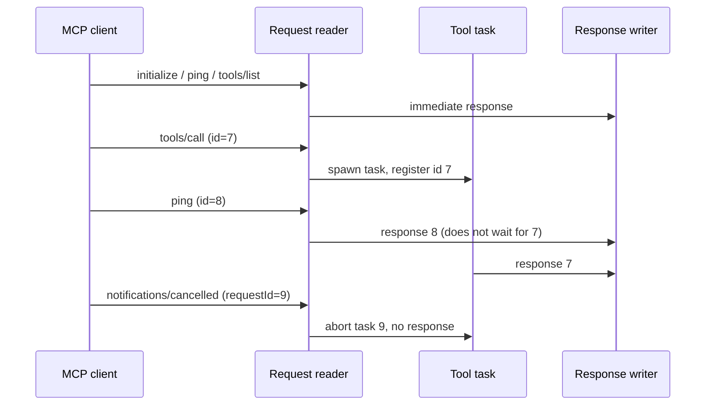

# MCP Server Core

**Version:** 1.1.1
**Status:** Stable
**Layer:** concept

## Overview

Defines what the godot-mcp server guarantees to an MCP client independently of the language it is written in: a line-delimited JSON-RPC 2.0 session over standard I/O, concurrent tool execution with cancellation, a strict separation between protocol frames and diagnostics, a uniform error contract, and a layered configuration model.

## Related Specifications

- [l1-editor-bridge.md](l1-editor-bridge.md) - The live-editor channel that most tool calls travel through.
- [l1-tool-catalog.md](l1-tool-catalog.md) - The tools the server exposes through `tools/list` and `tools/call`.
- [l1-agent-feedback.md](l1-agent-feedback.md) - The feedback channel: its settings and the guidance text it puts in the `initialize` answer. [ADDED]
- [l2-rust-stdio-server.md](l2-rust-stdio-server.md) - Implementation of this concept.

## 1. Motivation

An MCP client (Claude Code, Claude Desktop, Cursor, VS Code, Antigravity) treats the server's standard output as a protocol stream. A single stray line — an engine banner, a game's `print()` — corrupts the session, and strict clients drop the server. A tool call that waits on a busy editor must not freeze unrelated requests, and a client must be able to abandon a call it no longer needs. These guarantees were missing in the first public versions and were added after a simulation QA pass on 2026-10-14; this specification makes them explicit so they are not regressed.

## 2. Constraints & Assumptions

- Transport: line-delimited JSON-RPC 2.0 over stdin/stdout only. Batch requests are not supported and are rejected explicitly.
- Supported MCP protocol revisions: `2025-06-18`, `2025-03-26`, `2024-11-05` (newest first).
- The server exposes the `tools` capability only, with a list that is fixed for the life of the process (`listChanged: false`); the feedback setting decides at start-up which feedback tools it contains. [MODIFIED]
- The `initialize` answer may carry a short usage guidance text for the agent (`instructions`); the feedback channel uses it (FB-10). [ADDED]
- Configuration sources, highest precedence first: command-line flags, process environment (including an MCP client's `env` block), a `.env` file found in the working directory or a parent.
- Out of scope (roadmap): an HTTP/SSE transport. <!-- TBD: decide whether a network transport is needed at all before specifying it; it would reopen the loopback-only guarantee of the bridge. -->

## 3. Core Invariants

- **MCP-1 Pristine protocol channel.** Standard output carries only complete JSON-RPC frames, one per line. Every diagnostic goes to standard error. Any child process started by the server gets no handle to the protocol channel.
- **MCP-2 One answer per request.** Every request with a valid id receives exactly one response — except a request the client cancelled, which receives none. Notifications never receive a response.
- **MCP-3 No head-of-line blocking.** A slow or stalled tool call never delays `initialize`, `ping`, `tools/list`, or any other tool call. Tool calls run independently of the request reader.
- **MCP-4 Cancellation.** A `notifications/cancelled` for an in-flight request stops its work and suppresses its response.
- **MCP-5 Error contract.** Malformed input is answered with the standard JSON-RPC codes (parse error, invalid request, method not found, invalid params), preserving the request id when it is valid. A tool that fails returns a normal result flagged as an error whose text states what failed and lists at least one actionable recovery step.
- **MCP-6 Version negotiation.** `initialize` echoes the client's protocol revision when supported, otherwise answers with the newest supported revision.
- **MCP-7 Forgiving configuration.** An empty configuration value means "not set" (copied templates with blank placeholders must start the server). A configuration file that exists but cannot be parsed is reported on the diagnostics channel and ignored; it never stops the server. Removed settings left in the environment are ignored.
- **MCP-8 No crash paths.** Production code paths never abort the process on recoverable conditions; failures are typed errors converted into protocol errors or tool errors. Shared state survives a panicking task.
- **MCP-9 Graceful shutdown.** When the client closes the input stream, calls already running are allowed to finish and their responses are flushed before exit.

## 5. Detailed Design

### 5.1 Session Lifecycle

- The reader classifies each line as request, notification, or invalid message.
- `tools/call` is validated synchronously (tool name present and known), then executed as an independent task registered under the JSON text of its id.
- A single writer serializes responses so concurrent tasks never interleave partial lines.

### 5.2 Message Classification

| Input | Outcome |
| --- | --- |
| Not valid JSON | Parse error, id `null` |
| JSON but not an object (incl. arrays/batches) | Invalid request, id `null` |
| `jsonrpc` ≠ `"2.0"` or `method` not a string | Invalid request, id preserved when string/number |
| `id` present but not string/number | Invalid request |
| No `id` | Notification (only `notifications/cancelled` acts) |
| Unknown method | Method not found |
| `tools/call` without `name`, or unknown tool | Invalid params |

### 5.3 Configuration Keys

| Key | Purpose | Default |
| --- | --- | --- |
| `GODOT_PATH` | Engine executable used for headless operations; a set value is always used as given | when unset: auto-detect, then `godot` on `PATH` |
| `GODOT_DEBUG_PORT` | Editor bridge port | `9333` |
| `GODOT_MCP_TOKEN` | Shared bridge secret override | generated by the editor |
| `GODOT_CONSOLE_PATH` | Windows console wrapper; reserved, read only by the editor end-to-end tests | unset |
| `GODOT_MCP_FEEDBACK` | Agent feedback channel: `off`, `draft` (notes and drafts only) or `full` (adds submission after the human's approval) | `full` |
| `GODOT_MCP_GH_PATH` | GitHub command-line client used for submission | `gh` on `PATH` |

## 6. Implementation Notes

1. Logging initialization must happen before anything can write diagnostics, and must target standard error.
2. Child-process stdio isolation is enforced where processes are spawned (see [l1-tool-catalog.md](l1-tool-catalog.md) TL-6), not by the session loop.

## 7. Drawbacks & Alternatives

- **An off-the-shelf MCP SDK**: would provide negotiation and cancellation out of the box. Rejected for now — the hand-written loop is small, fully tested, and a migration is a large change; reconsider if the protocol surface grows (resources, prompts, sampling).
- **Sequential request handling**: simpler, but a 15-second editor timeout would block `ping` and make clients consider the server dead.

## Canonical References

| Alias | Path | Purpose |
| --- | --- | --- |
| `[SESSION]` | `src/server.rs` | Request reader, task spawning, cancellation, response writer |
| `[FRAMES]` | `src/protocol.rs` | JSON-RPC and MCP result types, error-with-hints helper |
| `[ERRORS]` | `src/error.rs` | Typed error taxonomy |
| `[CONFIG]` | `src/config.rs` | Configuration sources and precedence |

## Document History

| Version | Date | Author | Description |
| --- | --- | --- | --- |
| 1.0.0 | 2026-10-16 | Agent (magic.analyze first-time) | Reverse-engineered from the code at 94e4540; rationale taken from the 2026-10-14 simulation QA report (findings on stdout corruption, head-of-line blocking, protocol conformance, configuration loading). |
| 1.1.0 | 2026-10-16 | Agent (magic.spec) | [ADDED] Two configuration keys, the `initialize` guidance text and the link to the feedback concept; [MODIFIED] the tool list is fixed per process rather than static, because the feedback setting shapes it. |
| 1.1.1 | 2026-10-20 | Agent (magic.spec) | [MODIFIED] The `GODOT_PATH` row: a set value is always used as given. |
