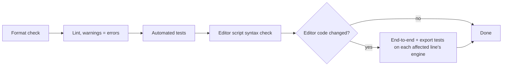

# Quality Assurance

**Version:** 1.1.0
**Status:** Stable
**Layer:** concept

## Overview

Defines how godot-mcp proves that its guarantees hold: which checks every change must pass, how behaviour that needs a real editor is tested without making every run depend on one, and which engine version each release line's editor-side code is proven against.

## Related Specifications

- [l1-mcp-server.md](l1-mcp-server.md) - Protocol guarantees under test.
- [l1-editor-bridge.md](l1-editor-bridge.md) - Editor-side guarantees under test.
- [l1-tool-catalog.md](l1-tool-catalog.md) - Tool contracts under test.
- [l1-distribution.md](l1-distribution.md) - DS-3: the release gate reuses this pipeline.
- [l1-release-lines.md](l1-release-lines.md) - RL-5: each line is verified against its own Godot version.
- [l2-test-suite.md](l2-test-suite.md) - Implementation of this concept.

## 1. Motivation

Most failures found so far were invisible to type checking: a script error on an older editor that sends no reply, a file not flushed on two of three operating systems, a game printing into the protocol stream. They were caught only by running the real thing on the right platform and version. This specification turns those lessons into standing requirements.

## 2. Constraints & Assumptions

- A real Godot binary is not available on every developer machine; tests that need one are opt-in locally and mandatory in CI.
- [MODIFIED] CI provides Windows, Linux and macOS runners and installs the Godot build of the line under test.
- The editor's script analyzer only warns about calls to methods the running engine lacks; such calls fail at run time.

## 3. Core Invariants

- **QA-1 Test first.** New behaviour and every bug fix come with a test that fails before the change and passes after it.
- **QA-2 Full pipeline before commit.** Formatting check, lint with warnings as errors, the complete automated test suite, and a syntax check of every editor script all pass before a change is committed.
- **QA-3 Editor changes run against a real editor.** [MODIFIED] Any change to the editor-side code is verified by the end-to-end and export tests against a real editor, on the Godot version of every line the change lands on.
- **QA-4 Real dependencies are opt-in.** Default test runs need no engine binary: they use a fake editor bridge and stand-in engine executables. Tests that need a real engine are skipped unless explicitly requested.
- **QA-5 Guards are proven.** Every security or data-safety guard has a test that fails when the guard is removed.
- **QA-6 Every platform, every push.** [MODIFIED] CI runs the pipeline on Windows, Linux and macOS for every push to the development line or a release line and for every pull request, plus the editor tests against that line's Godot version.
- **QA-7 Version-portable editor code.** [MODIFIED] Editor-side calls to APIs missing from the first release of the line's Godot minor version (M.N.0) are guarded by a runtime capability check; APIs present there are called directly.

## 5. Detailed Design

### 5.1 Test Layers

| Layer | Needs | Proves |
| --- | --- | --- |
| Unit | nothing | Path confinement, identifier pattern, schema checks, banner stripping |
| Protocol | the built server binary | Framing, error codes, concurrency, cancellation, configuration loading, stdout purity |
| Tool | temp project directories | File writes, project resolution, argument rejection |
| Bridge client | a fake editor bridge | Multiplexing, reconnection, timeouts, error classes |
| Process | stand-in engine executables | Detachment from the server's streams and process group |
| Editor end-to-end | the line's Godot build | Loopback + secret, scene tools, typed properties, undo fidelity, resource refresh |
| Export | the line's Godot build | Addon absent from an exported pack |
| Version sync | nothing | Server and addon versions equal; the line identity is consistent |

### 5.2 Pipeline

## 7. Drawbacks & Alternatives

- **Mocking the editor everywhere**: fast, but blind to engine-version API gaps — the class of bug the real-editor tests exist for.
- **Running real-editor tests by default**: slower and fails on machines without Godot; kept opt-in locally, mandatory in CI.

## Canonical References

| Alias | Path | Purpose |
| --- | --- | --- |
| `[CI]` | `.github/workflows/ci.yml` | Pipeline on every push and pull request |
| `[HELPERS]` | `tests/common/mod.rs` | Stdio session driver, fake editor bridge, stand-in engine executables |
| `[E2E]` | `tests/editor_e2e_test.rs` | Real-editor end-to-end tests |
| `[GUIDE]` | `AGENTS.md` | Contributor verification checklist |

## Document History

| Version | Date | Author | Description |
| --- | --- | --- | --- |
| 1.0.0 | 2026-10-16 | Agent (magic.analyze first-time) | Reverse-engineered from the test suite, CI workflow and contributor guide at 94e4540; lessons from the 2026-10-14 QA report and the first CI run (unflushed writes on Linux/macOS, a 4.8-only API call on 4.5). |
| 1.1.0 | 2026-10-20 | Agent (magic.spec) | [MODIFIED] QA-3, QA-6, QA-7 per release line: each line proven against its own Godot version, guards only for APIs missing from the line's M.N.0. Stable → RFC → Stable after Post-Update Review. |
