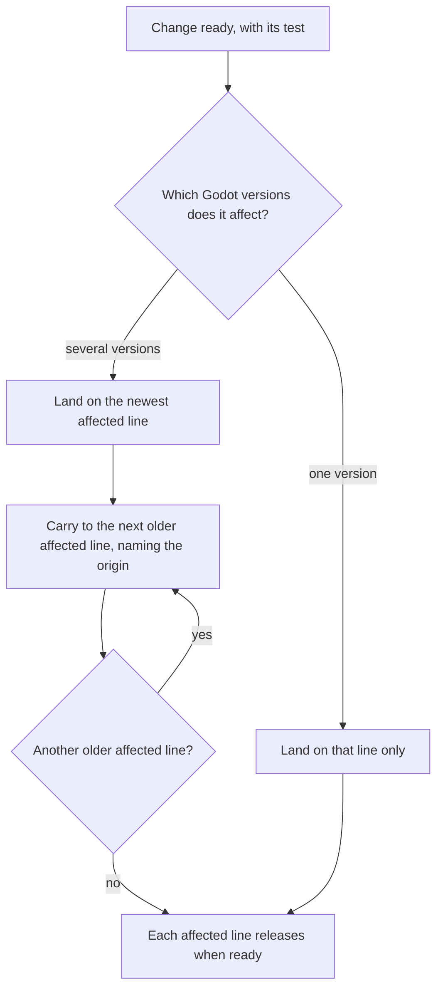
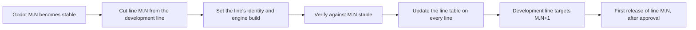

# Godot Release Lines

**Version:** 1.0.0
**Status:** Stable
**Layer:** concept

## Overview

godot-mcp is maintained as one release line per supported Godot minor version (4.5, 4.6, 4.7, …) plus one development line for the next Godot version that has no stable release yet. This specification defines what a line is, how a change reaches every line it affects, how a release names its line and its version number, and how lines are added and retired.

## Related Specifications

- [l1-distribution.md](l1-distribution.md) - What one release contains and when it may be published; every line releases under those rules.
- [l1-quality-assurance.md](l1-quality-assurance.md) - The checks each line passes against its own Godot version.
- [l1-editor-bridge.md](l1-editor-bridge.md) - BR-9: the version gate, applied by each line with its own minimum.
- [l1-community-health.md](l1-community-health.md) - The security policy and contributor guide that publish the line table.
- [l2-release-branches.md](l2-release-branches.md) - Implementation of this concept.

## 1. Motivation

Every Godot minor version adds, changes and sometimes removes editor APIs (`EditorFileSystem.is_importing` exists only from 4.7). A single build for "4.5 and newer" has to reach every newer API through a runtime capability check, and a missed check fails silently: the handler raises a script error, sends no reply, and the caller waits for its timeout — the 4.8-only call that broke 4.5 in the first CI run. One line per Godot version lets each line use its own version's API directly, be proven against exactly that version, and get a fix or a release without waiting for, or risking, the users of other Godot versions. A fix that matters to every version must still reach every version, so routing changes between lines is part of the concept rather than left to memory.

## 2. Constraints & Assumptions

- Godot's own model is followed so contributors meet a familiar flow: the default branch carries the next version in development, each released minor version has a maintenance branch, and a fix lands on the newest version first and is carried back to older ones.
- Godot patch releases of one minor version (4.6.0 … 4.6.3) keep the editor API the addon uses; a line covers every patch release of its minor version.
- State on 2026-10-20: the newest stable releases are 4.5.2, 4.6.3 and 4.7.2; 4.8 is in beta (4.8-beta1). The release lines to create are 4.5, 4.6 and 4.7; the development line targets 4.8.
- Releases published before the lines existed (0.1.0 … 0.4.0, one build for 4.5 and newer) stay published. Once every line has published its first release, they are unsupported.
- Out of scope: detecting a server and an addon from different lines at run time. Both version strings name their line (RL-3), so a mismatch is visible in every version report.
- **Assumption (forecast):** the development line publishes no releases; a user of an unstable Godot build builds the development line from source. Runner-up: publish pre-releases from the development line, marked as such. Override: `/magic.spec amend l1-release-lines.md "development line publishes pre-releases"`.
- **Assumption (forecast):** "the release for a Godot version is updated" means the line gets a new release with a higher version number; a published release is never replaced or re-uploaded. Runner-up: one rolling release per line whose files are replaced. Override: `/magic.spec amend l1-release-lines.md "one rolling release per line"`.
- **Assumption (forecast):** every line stays maintained until a maintainer retires it; there is no automatic end of life. Runner-up: keep only the newest N lines. Override: `/magic.spec amend l1-release-lines.md "maintain only the newest N lines"`.
- **Assumption (forecast):** an addon running in an editor of a newer Godot minor version than its line warns and keeps working; only an older minor version is refused, because there the APIs the line relies on may be missing. Runner-up: refuse every minor version except the line's own. Override: `/magic.spec amend l1-release-lines.md "refuse newer minor versions"`.
- **Assumption (forecast):** specifications and plans are maintained on the development line only. The copy a release line inherits when it is cut is a snapshot and is not edited there; line-specific differences are recorded on the development line. Runner-up: each line keeps its own planning. Override: `/magic.spec amend l1-release-lines.md "planning per line"`.

## 3. Core Invariants

- **RL-1 One line per Godot minor version.** Each supported Godot minor version has exactly one release line, kept on its own long-lived branch. A line covers every patch release of that minor version.
- **RL-2 Development line on the default branch.** The default branch is the development line. It targets the newest Godot minor version that has no stable release yet, receives new work first, and publishes no releases. When that Godot version becomes stable, a release line is cut from the development line for it, and the development line moves on to the next minor version.
- **RL-3 The line is part of the version.** Every version string names the Godot minor version of its line, so the server, the addon, the release tag, the release title, the release notes heading, every release file name and every version report show which Godot version a build is for. The server and the addon of one line always carry the same string (DS-1).
- **RL-4 Line-exact runtime gate.** A line's addon refuses to start in an editor older than its line's Godot minor version (BR-9, with the line's minimum). In an editor of a newer Godot version it starts and warns, naming the line to install instead.
- **RL-5 Line-exact verification.** Each line is verified against its own Godot version: a release line against the newest stable patch release of its minor version, the development line against the newest pre-release of its target version. The exact engine build a line is verified against is recorded in the line and changes only through a commit.
- **RL-6 Route by affected lines.** A change that concerns one Godot version only lands on that line only. A change that affects several lines — a fix or an improvement — lands first on the newest affected line (the development line whenever it is affected) and is then carried to each older affected line, newest to oldest. Carrying means applying the same change as a new commit on the older line; each carried copy names the change it was carried from.
- **RL-7 No silent gaps.** Before a line is released, every product change landed on a newer line since the line's previous release (since its cut, for its first release) is either present on it or confirmed by the approving maintainer not to apply to it.
- **RL-8 One numbering for all lines.** Every release takes the next version number above the highest number released so far — on any line, or before the lines existed — bumped by the kind of change: a fix bumps the patch number; a feature or a breaking change bumps the minor number while the project is before 1.0. Lines released in one release session for the same change set share that number; a line-only release takes a number of its own. A number therefore never means two different change sets, and a published release is never replaced.
- **RL-9 Default download is the newest stable line.** Where the distribution channel offers a single "latest" release, it is the newest release of the newest stable line. Every release states its Godot version in its title, and the installation guide tells users to pick the release that matches their Godot version.
- **RL-10 One published line table.** The lines — each with its Godot versions, branch, status and the release a user should install — are published in the installation guide, the security policy and the contributor guide. The table is identical on every line; cutting or retiring a line updates all three documents in the same change, on every line.
- **RL-11 Few line-specific files.** What identifies a line (its version string, its minimum engine version, the engine build it is verified against, its release notes) lives in a small fixed set of files. Every other product file is identical on all lines unless the line's Godot version forces a difference, and each forced difference is listed in the line deviations record kept on the development line.
- **RL-12 Retirement by decision.** A line is retired only by a maintainer's explicit decision. A retired line keeps its branch and its releases, receives no further changes, and is shown as retired in the line table.

## 5. Detailed Design

### 5.1 Lines on 2026-10-20

| Line | Godot versions | Role |
| --- | --- | --- |
| 4.5 | 4.5.x | release line |
| 4.6 | 4.6.x | release line |
| 4.7 | 4.7.x | release line, newest stable: the default download |
| 4.8 | 4.8 pre-releases | development line (default branch), no releases |

The exact engine build each line is verified against is recorded per line ([l2-release-branches.md](l2-release-branches.md) §5.1).

### 5.2 Routing a Change

Which lines a change affects is established by running its test on each candidate line, not by reading the code: a bug that the test reproduces on a line affects that line.

### 5.3 Release Numbering

Example sequence, each row one release decision:

| Change | Lines released | Number | Why |
| --- | --- | --- | --- |
| First line releases (new tag and file format) | 4.5, 4.6, 4.7 | 0.5.0 | shared, new minor version |
| Fix for a 4.6-only API change | 4.6 | 0.5.1 | line-only, next number above 0.5.0 |
| Fix affecting every line | 4.5, 4.6, 4.7 | 0.5.2 | shared; 4.5 and 4.7 skip 0.5.1, which they never had |
| New tool on every line | 4.5, 4.6, 4.7 | 0.6.0 | shared feature |

Lines released in one session share one approval, which also covers the list of changes confirmed not to apply (RL-7). A line that is not ready in that session is released later under a number of its own.

### 5.4 Line Lifecycle

A Godot patch release (M.N.P) moves the affected line's verified engine build forward through a commit; a release follows only if the newer build needed a change.

### 5.5 Initial Cut

1. Work pending on the development line is finished first, so all lines start from one commit.
2. The development line becomes line-aware in one change: identity for 4.8, the line table, the line-aware checks and release procedure.
3. Lines 4.5, 4.6 and 4.7 are cut from that commit; each sets its identity and engine build in one change.
4. Each line then drops the capability checks its Godot version no longer needs, and only where its verification passes without them (on 4.7 and the development line: the import-state check).
5. Publishing the branches, the repository settings and the first releases (0.5.0 on all three lines) each wait for a maintainer's approval (DS-7).

## 7. Drawbacks & Alternatives

- **One build for every Godot version with capability checks (status quo):** one branch to maintain, but every newer API needs a check, and a missed one fails silently on older editors; rejected (see Motivation).
- **Merge forward (fix the oldest line, merge it into newer ones):** a fix is one commit, but line-specific workarounds would flow into newer lines and every merge would need them undone by hand; Godot itself carries fixes backwards; rejected.
- **One repository per Godot version:** clean separation, but every shared change crosses repositories and the history splits; rejected.
- **Line in a separate field instead of the version string:** keeps version numbers plain, but adds a second value to keep in sync and leaves version reports blind to the line; rejected.
- **Releases from the development line:** useful for early adopters of a Godot beta; deferred (see the forecast in Constraints).

## Canonical References

| Alias | Path | Purpose |
| --- | --- | --- |
| `[MANIFEST]` | `Cargo.toml` | Version string of the line |
| `[ADDON]` | `addons/godot_mcp/plugin.cfg` | Addon version string of the line |
| `[GATE]` | `addons/godot_mcp/plugin.gd` | Minimum engine version of the line |
| `[SKILL]` | `.agents/skills/release/SKILL.md` | Procedure for carrying, releasing, cutting and retiring lines |
| `[README]` | `README.md` | Installation guide with the line table |

## Document History

| Version | Date | Author | Description |
| --- | --- | --- | --- |
| 1.0.0 | 2026-10-20 | Agent (magic.spec) | Created from the request to maintain one branch per Godot version (4.5 to the newest stable, with the default branch on the unstable version) and to carry shared fixes to every release branch. Promoted to Stable after Post-Update Review. |
