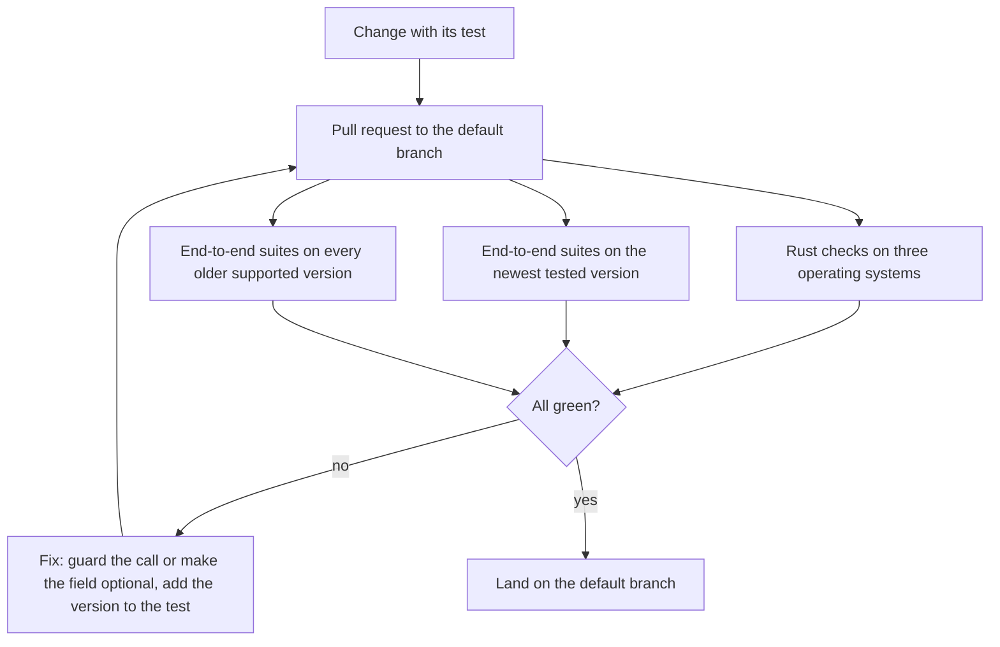
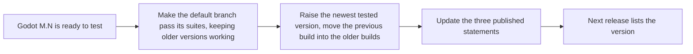

# Supported Godot Versions & One Build

**Version:** 2.0.0
**Status:** Stable
**Layer:** concept

## Overview

> The file name is historical: until 2026-11-20 the project kept one release line per Godot minor version. The identifiers `RL-1` to `RL-12` keep their numbers and now describe the single-build model.

godot-mcp is one codebase on the default branch that serves a contiguous range of Godot minor versions (4.5 to 4.8 on 2026-11-20). This specification defines how the range is declared, how every change is proven against every version in it, how one release made from the default branch serves all of them, and what happened to the release lines that preceded this model.

## Related Specifications

- [l1-distribution.md](l1-distribution.md) - What one release contains and when it may be published.
- [l1-quality-assurance.md](l1-quality-assurance.md) - The checks every change passes, on every supported Godot version.
- [l1-editor-bridge.md](l1-editor-bridge.md) - BR-9: the version gate, applied with the range's minimum and newest tested version.
- [l1-community-health.md](l1-community-health.md) - The security policy and contributor guide that publish the range.
- [l2-release-branches.md](l2-release-branches.md) - Implementation of this concept (the file name is historical too).

## 1. Motivation

Every Godot minor version adds, changes and sometimes removes editor APIs (`EditorFileSystem.is_importing` exists only from 4.7). A build for "4.5 and newer" has to reach every newer API through a runtime capability check, and a missed check fails silently: the handler raises a script error, sends no reply, and the caller waits for its timeout. That failure was the reason for one release line per Godot version, with a branch, a version string, a build and a carried copy of every change per line.

Running the whole suite of the project on Godot 4.5, 4.6, 4.7 and 4.8 showed what the lines had become: the same sources passed everywhere once a handful of calls were written in a tolerant form, and the lines differed only in those forms and in the files that name the line. The cost of the lines was real and recurring: every shared change was applied three or four times and verified on each copy, every release was three or four builds under one number, and the release files carried a Godot version a user had to choose correctly.

The risk the lines removed is not gone, so the single build keeps its answer to it: every supported Godot version runs the complete end-to-end suites on every change (RL-5), and what an older version lacks is called behind a capability check that those suites exercise (RL-6).

## 2. Constraints & Assumptions

- Godot's patch releases of one minor version (4.6.0 to 4.6.3) keep the editor API the addon uses; a supported minor version covers every patch release of it.
- State on 2026-11-20: the newest stable releases are 4.5.2, 4.6.3 and 4.7.2; 4.8 is in beta (4.8-beta2) and is the newest version the suites run against.
- Releases made before the range model are history and unsupported. Releases 0.1.0 to 0.4.0 were one build for 4.5 and newer; releases 0.5.1 to 0.15.0 were built once per Godot version from release lines (branches `godot-v4.5`, `godot-v4.6`, `godot-v4.7`, tags `vX.Y.Z+godot.M.N`, files ending in `-godotM.N`). Release 0.5.0 was published once per line and withdrawn, its tags kept so the number is never reused.
- Out of scope: running a server and an addon of different releases together; the server and the addon of one release carry the same number (DS-1), so a mismatch is visible in every version report.
- **Assumption (forecast):** a Godot minor version newer than the newest tested one is not refused: the addon starts and warns, because the editor API is stable across minor versions far more often than not and a refusal would block users on every Godot release day. Runner-up: refuse every untested version. Override: `/magic.spec amend l1-release-lines.md "refuse untested Godot versions"`.
- **Assumption (forecast):** the newest tested version may be a pre-release; the range is extended to the next stable version by the maintainers' decision, not automatically. Runner-up: test only stable versions. Override: `/magic.spec amend l1-release-lines.md "test stable versions only"`.
- **Assumption (forecast):** the oldest supported version stays supported until a maintainer drops it; there is no automatic end of life. Runner-up: keep only the newest N versions. Override: `/magic.spec amend l1-release-lines.md "support only the newest N Godot versions"`.

## 3. Core Invariants

- **RL-1 One codebase.** The default branch is the only line of development and the only source of releases. One build serves every supported Godot minor version; no branch exists per Godot version.
- **RL-2 One declared range.** The supported range is a contiguous run of Godot minor versions with an oldest supported version and a newest tested version. It is declared once, in the addon, and every other statement of it (the engine builds CI runs, the project the addon is developed in, the documents that publish it) is checked against that declaration by an automated test.
- **RL-3 The version names no Godot version.** A release version is `X.Y.Z`, and the default branch between releases is `X.Y.Z-dev`. The server and the addon carry the same string (DS-1). No Godot version appears in the version, the tag or a file name; a running server adds the commit it was built from (DS-9).
- **RL-4 Range-exact runtime gate.** The addon refuses to start in an editor older than the oldest supported version and says so. In an editor newer than the newest tested version it starts and warns, naming the range that was tested.
- **RL-5 Verified on every supported version.** Every supported Godot minor version runs the end-to-end suites on every change before it lands, on the newest stable patch build of that minor version (the newest tested version on its newest available build). The builds are recorded in the repository and change only through a commit. A change that fails on any supported version does not land.
- **RL-6 One portable change.** A change is written once, for the whole range: an API missing from the first release of the oldest supported version is called behind a runtime capability check, an answer field that only newer versions can fill is optional, and a behaviour that really differs between versions is covered by a test that names the version. Nothing is carried between branches.
- **RL-7 Nothing unverified is released.** A release is made only from a commit of the default branch on which the verification of RL-5 has passed for every supported version.
- **RL-8 One release, one number.** Every release takes the next number above the highest released so far, bumped by the kind of change (DS-10), and holds one server archive per platform and one addon archive, all built from the tagged commit. A published release is never replaced.
- **RL-9 The latest release serves every supported version.** The channel's "latest" release is the download for every Godot version in the range; the installation guide states the range and no step asks a user to choose a file by Godot version.
- **RL-10 One published range.** The supported range is published in the installation guide, the security policy and the contributor guide, in the same words. Changing the range updates all three in the same change.
- **RL-11 Few places hold the range.** The oldest supported and newest tested versions, the engine build of the newest version, the engine builds of the older ones, and the feature tag of the development project are the only product files that name the range; the release notes of all versions are one changelog.
- **RL-12 Support ends by decision; retired lines stay as history.** The oldest supported version is dropped only by a maintainer's explicit decision, by raising the oldest supported version; the last release that supports it stays available. The retired release-line branches, their tags and the releases built from them are kept as they are, receive no further commits or releases, and are never deleted.

## 5. Detailed Design

### 5.1 Supported Versions on 2026-11-20

| Godot | Role | Engine build the suites run on |
| --- | --- | --- |
| 4.5 | oldest supported | 4.5.2-stable |
| 4.6 | supported | 4.6.3-stable |
| 4.7 | supported | 4.7.2-stable |
| 4.8 | newest tested | 4.8-beta2 |
| newer than 4.8 | starts with a warning | not tested |
| older than 4.5 | refused | not supported |

Where each value is kept is in [l2-release-branches.md](l2-release-branches.md) §5.2.

### 5.2 How a Change Meets Every Version

Which versions a change affects is established by running its test on each of them, which CI does for every change; nobody decides it by reading the code.

### 5.3 Release Numbering

A release takes the number the changes since the last release imply (DS-10):

| Change | Number |
| --- | --- |
| A fix for one Godot version or for all of them | patch |
| A new tool or capability | minor |
| A breaking change | minor, called out in the notes, while the project is before 1.0 |
| Dropping the oldest supported version | minor, called out in the notes |

The first release made this way follows 0.15.0, the last release built per Godot version.

### 5.4 Changing the Range

Adding a version never needs a new branch. A new Godot patch release of a supported minor version moves that version's build forward through a commit; a release follows only when the newer build needed a change.

Dropping the oldest version is the reverse: the oldest supported version is raised, its builds leave the verification, the guarded calls that only it needed may become direct calls, and the three published statements change in the same commit.

### 5.5 The Retired Lines

Branches `godot-v4.5`, `godot-v4.6` and `godot-v4.7`, their `vX.Y.Z+godot.M.N` tags and the releases 0.5.1 to 0.15.0 are history. A fix reaches users of every Godot version through the next release from the default branch; nothing is applied to a retired branch.

## 7. Drawbacks & Alternatives

- **One build with capability checks and verification on the newest version only (the model before the lines):** one branch, but a missed check on an older editor was found by users; rejected. The single build here differs in verifying every version.
- **One release line per Godot version (the model of releases 0.5.1 to 0.15.0):** each version proven alone and releasable alone, but every shared change was carried and verified once per line, and the sources of the lines had converged; retired on 2026-11-20 after one codebase passed every suite on every version.
- **A server and addon build per Godot version from one codebase:** the binaries would be identical, so the file names would carry a choice that changes nothing; rejected.
- **Merge forward from the oldest version:** moot without branches.
- **Refusing untested newer Godot versions:** safer on paper, but it blocks users the day a Godot version ships; deferred (see the forecast in Constraints).

## Canonical References

| Alias | Path | Purpose |
| --- | --- | --- |
| `[MANIFEST]` | `Cargo.toml` | Version of the server |
| `[ADDON]` | `addons/godot_mcp/plugin.cfg` | Version of the addon |
| `[GATE]` | `addons/godot_mcp/plugin.gd` | Oldest supported and newest tested Godot minor version |
| `[BUILD]` | `.github/godot-version` | Engine build of the newest tested version |
| `[CI]` | `.github/workflows/ci.yml` | Suites on every supported version |
| `[SKILL]` | `.agents/skills/release/SKILL.md` | Procedures for landing, releasing, supporting a new Godot version and dropping the oldest |
| `[README]` | `README.md` | Installation guide with the supported range |

## Document History

| Version | Date | Author | Description |
| --- | --- | --- | --- |
| 1.0.0 | 2026-10-20 | Agent (magic.spec) | Created from the request to maintain one branch per Godot version (4.5 to the newest stable, with the default branch on the unstable version) and to carry shared fixes to every release branch. Promoted to Stable after Post-Update Review. |
| 1.1.0 | 2026-10-20 | Agent (magic.spec) | [MODIFIED] RL-3, RL-7, RL-8, RL-9, RL-10, RL-11: one release per number containing the files of every supported line, the release named by its number alone; replaces one release per line after the first release showed three near-identical entries per version. Reviewed against the practice of Godot add-ons that ship binaries. |
| 1.1.1 | 2026-11-02 | Agent (magic.spec) | The example of add-ons that publish one release per project version no longer names a third-party add-on the project has no use for. No requirement changed. |
| 2.0.0 | 2026-11-20 | Agent (magic.spec) | Rewritten (major) for one build serving Godot 4.5 to 4.8 from the default branch; the release lines, their branches, line tags, `-godotM.N` file names, the `+godot.M.N` version metadata, carrying between branches and `.github/lines` are gone. Source: CI showed one codebase passing every suite on every version, the lines differing only in tolerant call forms and identity files. RL-1 to RL-12 keep their numbers with new meaning: RL-1 one codebase (was one line per Godot minor version), RL-2 one declared range (was development line on the default branch), RL-3 the version names no Godot version (was the line in the version), RL-4 range-exact gate, RL-5 verified on every supported version, RL-6 one portable change (was routing by affected lines), RL-7 nothing unverified is released (the no-silent-gaps check has no subject without branches), RL-8 one release one number, RL-9 latest release serves every version, RL-10 one published range (was the line table), RL-11 few places hold the range, RL-12 support ends by decision and retired lines stay as history. The previous Assumption about planning on the development line only is dropped: there is one line. Stable → RFC → Stable after Post-Update Review; C12 quarantine of l2-release-branches.md applied and lifted in the same pass. |
