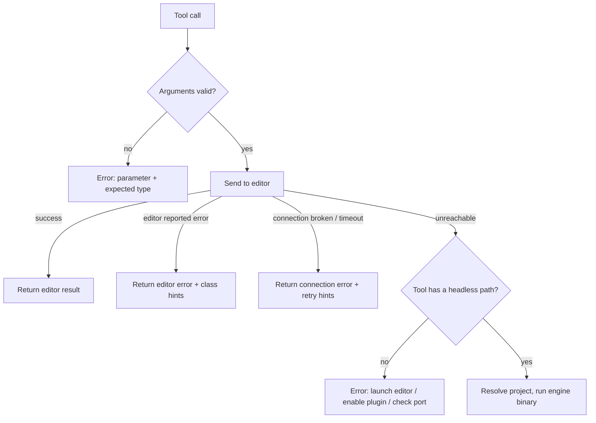

# Tool Catalog

**Version:** 1.9.0
**Status:** Stable
**Layer:** concept

## Overview

Defines the set of MCP tools godot-mcp offers, how each one chooses between the live editor and the headless engine, how a project directory is found when the caller does not name one, and the safety rules every tool that touches files or launches the engine must follow.

## Related Specifications

- [l1-mcp-server.md](l1-mcp-server.md) - Session, error contract and cancellation the tools run under.
- [l1-editor-bridge.md](l1-editor-bridge.md) - Commands behind the editor-backed tools.
- [l1-agent-feedback.md](l1-agent-feedback.md) - The feedback tools of this catalog and the rules specific to them (FB-1 to FB-11). [ADDED]
- [l2-tool-handlers.md](l2-tool-handlers.md) - Implementation of this concept.
- [l1-content-authoring.md](l1-content-authoring.md) - Tools for creating scenes and resources, attaching scripts, connecting signals and changing project settings. [MODIFIED]
- [l1-runtime-observability.md](l1-runtime-observability.md) - Tools for observing and driving a running game, and debugging a managed one. [MODIFIED]
- [l1-code-intelligence.md](l1-code-intelligence.md) - GDScript queries answered by Godot's language server. [ADDED]
- [l1-project-adapter.md](l1-project-adapter.md) - The project's own states and commands in a running game (PA-1 to PA-10). [ADDED]

## 1. Motivation

Agents call tools without seeing the implementation; a tool's contract has to be predictable from its schema and description alone. Tools that write files or start processes are where an agent can do real damage — overwrite a user's script, write outside the project, inject an engine option, or start a game that dies with the agent's terminal. This specification fixes those boundaries for every current and future tool.

## 2. Constraints & Assumptions

- A tool is "editor-backed" when it needs a running editor with the bridge enabled, "host-side" when it runs without one, and "live-first" when it prefers the editor and falls back to the engine binary.
- The headless engine is only invoked for: version lookup, script validation, editor launch, and running the project.
- Tool names are stable public API (`godot_*`); renaming one is a breaking change.
- [DR] Node names are not held to the identifier pattern. The pattern protects generated source and command lines, and a node name never goes into either; the editor tools already accepted `שלום` and `with space`, and rejecting them would break scenes named in any non-Latin script. Rejected: tightening the tools to the pattern (a regression for those users) and a separate stricter pattern (no threat it would stop). Override: `/magic.spec amend l1-tool-catalog.md "strict node names"`.
- [DR] A stop without a run id ends every running game, not only the newest: the agent asked to stop "the project", and a game left running (a window, a held game that never advances) is the harm the tool exists to prevent. Rejected: stopping only the newest run (leaves the others), and refusing when several run (a stall). Override: pass `run_id`.
- The three feedback tools are host tools that follow, besides the rules below, those of [l1-agent-feedback.md](l1-agent-feedback.md). The human can switch them off or reduce them to two by configuration, so which feedback tools `tools/list` shows is fixed at start-up by that setting. [ADDED]

## 3. Core Invariants

- **TL-1 Schema-first validation.** Every tool publishes an input schema. Required parameters, primitive types, array item types, enumerations and the numeric ranges the tool documents (a line, a column, a tick count) are checked before the editor or the engine is contacted; a violation names the parameter, the expected type and the received type. A parameter that is an object or a list of objects whose fields the caller must get right (`steps`, `until`, `roi`) describes those fields in its schema, so the caller does not have to guess them. [MODIFIED]
- **TL-2 Live-first, fall back only on absence.** A live-first tool uses the engine binary only when the editor is unreachable. An editor that answered with an error is reported as such and never masked by a fallback.
- **TL-3 Project resolution order.** When a tool needs a project directory: an explicit `project_path` wins; otherwise the project open in the connected editor (for tools that may use the editor); otherwise the nearest directory at or above the server's working directory that contains `project.godot`; otherwise the single direct subdirectory that contains one. Several candidates are an error that lists them and asks for `project_path`. A given `project_path` must contain `project.godot`.
- **TL-4 Confined, non-destructive writes.** Host-side writes resolve inside the project only: parent-directory segments are rejected, absolute paths must land inside the project, and the existing part of the path may not leave the project through a link. An existing file is never replaced unless the caller explicitly asks for it. A write is flushed before success is reported.
- **TL-5 No injection.** No caller-supplied string reaches the engine command line where it could be read as an option, and none is interpolated into generated source code. Class identifiers must match `^[A-Za-z_][A-Za-z0-9_]*$`; a node name is data, not an identifier: it reaches the engine only as a value, never inside generated source or a command line, and any name Godot accepts is accepted (Godot replaces the characters it forbids and the answer reports the real name); every file argument that names a project file (a scene, a script, a resource, the file of a breakpoint) must be a `res://` path without parent segments. [MODIFIED]
- **TL-6 Detached launches.** Processes started for the caller (editor, game) are detached: they receive no handle to the server's standard streams, do not inherit the server's console or process group, and keep running when the server or the client terminal is interrupted. The one exception is a managed process run (`godot_run_project` with `mode: "process"`, or without an editor), which the caller asked the server to observe and drive: it too gets no handle to the server's streams and has its own process group, but it belongs to the server, is stopped with `godot_stop_project` and ends with the server. [MODIFIED] A helper program that a tool waits for, such as the exporter of `godot_check_voxel_model`, is not detached; its rules are CA-13 of [l1-content-authoring.md](l1-content-authoring.md). [ADDED]
- **TL-7 Hints by failure class.** Every tool error carries recovery steps matched to what failed: editor unreachable, connection broken or busy, editor-reported failure (unauthorized, no active scene, not found, unsaved changes in the editor), failure reported by the running game (denied, unsupported, not found, bad parameters), invalid arguments, engine binary failure (a missing or non-running Godot executable names `GODOT_PATH`). A generic instruction that fits every failure ("correct the arguments and retry") is not a recovery step. Project files in messages are named by their `res://` path. [MODIFIED]
- **TL-8 Bounded engine calls.** Engine invocations expected to finish (version lookup, script validation) have a time limit and report it when exceeded; their output is stripped of the engine banner.
- **TL-9 Editor stays in sync.** After a host-side write into the project the connected editor has open, the editor is asked to refresh that file so it is picked up (and assigned a UID) without a manual rescan.
- **TL-10 The named project wins over the editor.** A tool given `project_path` acts on that project. When a connected editor has a different project open, the editor is not used for the call: the tool takes its host-side path when it has one (reading and editing a script, creating a scene or a resource, project settings), and otherwise refuses with both directories and the fix. An answer that changed a file or a setting names the project directory it acted on. [ADDED]
- **TL-11 Stopping and asking about runs are honest.** `godot_stop_project` without a run id stops everything that runs: the editor's Play mode when it plays, and every managed run that is still running; the answer lists each one it stopped, or says that nothing was running. `godot_get_run_status` and `godot_run_output` answer that nothing runs when that is so, and do not report an absent editor as a failure when no editor is needed. [ADDED]

## 5. Detailed Design

### 5.1 Catalog

| Tool | Mode | Mutates | Summary |
| --- | --- | --- | --- |
| `godot_get_version` | live-first | no | Engine version from the editor, else the binary |
| `godot_get_project_info` | editor | no | Name, main scene, features, directory |
| `godot_launch_editor` | host | process | Starts the editor for the resolved project |
| `godot_run_project` | live-first | process / play state | Editor Play mode; without an editor (or with `mode: "process"`) a managed game with the remote debugger attached; `user_args` (managed run only) go to the game after `--` [MODIFIED] |
| `godot_stop_project` | live-first | play state | Stops editor Play mode and managed runs, and says which [MODIFIED] |
| `godot_get_run_status` | live-first | no | Whether a scene plays, and the managed runs [MODIFIED] |
| `godot_get_open_scenes` | editor | no | Open tabs, active tab |
| `godot_open_scene` | editor | editor state | Opens a scene tab |
| `godot_save_scene` | editor | disk | Saves the active scene |
| `godot_get_scene_tree` | editor | no | Node hierarchy, scene-relative paths |
| `godot_add_node` | editor | scene (undoable) | Any instantiable Node class or global script class |
| `godot_remove_node` | editor | scene (undoable) | Root is protected |
| `godot_get_node_properties` | editor | no | `{type, value}` per editor-visible property |
| `godot_set_node_properties` | editor | scene (undoable) | All-or-nothing, read-back |
| `godot_capture_viewport` | editor (windowed) | editor state | PNG of the 2D/3D viewport with dimensions |
| `godot_create_script` | host | disk | `.gd` from the caller's `content`, validated after writing, or from a fixed template; no overwrite by default [MODIFIED] |
| `godot_validate_script` | host | no | Headless syntax check |
| `godot_resave_resources` | editor | editor file system | Re-import / refresh after external edits |
| `godot_check_voxel_model` | host (the import goes through the editor when it has the project open) | disk, editor file system, a helper process | Exports 1 to 16 `.vox` models through an external exporter into `.glb` files inside the project, imports them and checks the result; the exporter is a trusted program [ADDED] |
| `godot_create_scene` | live-first | disk, editor state | Scene with one root node; never replaces a scene [ADDED] |
| `godot_attach_script` | editor | scene (undoable) | Attaches or detaches a script [ADDED] |
| `godot_read_script` | live-first | no | Text of a script as the editor would save it, with whether the editor holds unsaved changes and a version label |
| `godot_edit_script` | live-first | disk, editor state (undoable) | Replaces one fragment of an existing script; refused while the editor holds unsaved changes to it |
| `godot_connect_signal` | editor | scene (undoable) | Persistent connection inside the edited scene [ADDED] |
| `godot_list_signals` | editor | no | Signals of a node and their connections [ADDED] |
| `godot_create_resource` | live-first | disk | `.tres` of a built-in Resource class; never replaces a file [ADDED] |
| `godot_get_project_settings` | live-first | no | Settings from the editor, else from `project.godot` [ADDED] |
| `godot_set_project_setting` | live-first | disk | One scalar setting, type-checked and escaped [ADDED] |
| `godot_create_project` | host | disk | Minimal Godot 4 `project.godot` in a new or existing directory; never replaces a project and installs nothing else [ADDED] |
| `godot_run_output` | host | no | Bounded logs, warnings and errors with stacks of a run [ADDED] |
| `godot_game_tree`, `godot_game_get`, `godot_game_signals`, `godot_game_snapshot` | game | no | Live tree, properties, signals, summary of the running game [ADDED] |
| `godot_game_set`, `godot_game_call`, `godot_game_observe` | game | running game only | Property writes, including a `/` Object or Dictionary path (an unknown property is an error), permitted method calls, short signal observation [MODIFIED] |
| `godot_game_input`, `godot_game_input_release`, `godot_game_wait`, `godot_game_physics` | game | running game only | Key, Input Map action, mouse, touch and gamepad input, gestures, drags along a path or a circle, waits for frames, a node, a signal, a property value or a newer scene, time scale, a step of N physics ticks [ADDED] |
| `godot_game_state` | game | no | Values of the state the project's adapter registered, the adapter's status and its commands with their help [ADDED] |
| `godot_game_command` | game | what the project's command does | Runs one command the project's adapter registered, by name, with a dictionary of arguments [ADDED] |
| `godot_game_scenario` | game | managed process run only | One held play-through: Input Map actions and pointers, a known number of physics ticks per step, body and property snapshots, logs; one scenario per run; releases all input when it ends [ADDED] |
| `godot_game_screenshot` | game (windowed) | session memory of the run | PNG of the game, an optional frame sheet, pixel diff against the previous capture, named baselines with a region and a tolerance [ADDED] |
| `godot_game_record` | game (windowed) | PNG files below the system temporary directory | Up to 240 frames of the game window written after the last grab; optional gif or mp4 through `ffmpeg`; refused while held [ADDED] |
| `godot_debug_breakpoints`, `godot_debug_control`, `godot_debug_state` | managed run | running game only | Breakpoints, pause, resume and step, stack and variables [ADDED] |
| `godot_code_diagnostics`, `godot_code_symbols`, `godot_code_complete`, `godot_code_definition`, `godot_code_references` | engine | no | GDScript queries from Godot's language server [ADDED] |
| `godot_note_feedback` | host | session memory | Records one observation for the maintainers |
| `godot_draft_feedback` | host (asks the editor or engine for its version) | session memory | Assembles a report from notes; no network |
| `godot_submit_feedback` | host | public issue | Publishes a draft after the human's approval; only when feedback mode is `full` |

### 5.2 Live-First Decision

## 7. Drawbacks & Alternatives

- **Headless `--headless` for the fallback game run**: rejected — a visible game window is what a caller of "run project" expects.
- **Free-form script content in `godot_create_script`**: [MODIFIED] accepted as the optional `content` parameter. It was rejected to keep generated code free of caller text, but `content` is not interpolated into generated code: it is the whole file, written as given, the way `godot_edit_script` already writes caller text. Callers passed it anyway and, before unknown keys were refused, got the template back with a success answer. `content` replaces the template, so it cannot be combined with `extends_class` or `class_name`; it is limited to 1 MiB like the other script tools; after writing, the script goes through the `godot_validate_script` check, and a failing check is an error answer while the file stays written for `godot_edit_script`. An engine that cannot run leaves the script unchecked, which the answer says.

## Canonical References

| Alias | Path | Purpose |
| --- | --- | --- |
| `[TOOLS]` | `src/tools.rs` | Catalog, dispatch, fallback and hint logic |
| `[SCHEMA]` | `src/validation.rs` | Argument checks against the input schema |
| `[PATHS]` | `src/paths.rs` | Project discovery, confinement, identifier pattern |
| `[ENGINE]` | `src/cli_runner.rs` | Engine invocations and detached launches |

## Document History

| Version | Date | Author | Description |
| --- | --- | --- | --- |
| 1.0.0 | 2026-10-16 | Agent (magic.analyze first-time) | Reverse-engineered from the code at 94e4540; rationale from the 2026-10-14 simulation QA report (script writes outside the project, engine option injection, fallback masking editor errors, Ctrl+C killing launched editors, inherited stdio handles on Windows). |
| 1.1.0 | 2026-10-16 | Agent (magic.spec) | [ADDED] Three feedback tools in the catalog table, a constraint on their configuration-dependent presence, and the link to the feedback concept. |
| 1.2.0 | 2026-10-21 | Agent (magic.spec) | [ADDED] The authoring, running-game, debugger and language-server tools in the catalog; [MODIFIED] the run, stop and status rows and TL-6 for managed process runs; links to the three concepts that are now Stable. |
| 1.3.0 | 2026-10-21 | Agent (magic.spec) | [MODIFIED] The wait, screenshot and physics rows after pull request 18. |
| 1.3.1 | 2026-10-21 | Agent (magic.spec) | Document History rows put in version order. No requirement changed. |
| 1.4.0 | 2026-10-21 | Agent (magic.run) | [ADDED] The `godot_read_script` and `godot_edit_script` rows; the alternative about script content now points to them. Stable → RFC → Stable after Post-Update Review. |
| 1.5.0 | 2026-10-21 | Agent (magic.spec) | [ADDED] TL-10 (the named project wins over a connected editor) and TL-11 (honest stop and status answers); [MODIFIED] TL-1 (ranges, object schemas), TL-5 (every project file argument; node-name question left open), TL-7 (hint classes, no generic hint, `res://` spelling). Source: simulation QA of 2026-10-21 (Q1, Q4, Q12, Q20, Q21, Q22, Q24, Q25, Q26, Q28). Stable → RFC → Stable after Post-Update Review. |
| 1.6.0 | 2026-10-21 | Agent (magic.spec) | [MODIFIED] TL-5: node names are data and any name Godot accepts is accepted; the identifier pattern stays for class identifiers. Resolves the open question of 1.5.0. `AGENTS.md` ("Identifier Sanitization") must follow. Stable → RFC → Stable after Post-Update Review. |
| 1.7.0 | 2026-10-26 | Agent (magic.spec) | [ADDED] `godot_create_project`, `godot_game_scenario` and `godot_check_voxel_model` in the catalog; [MODIFIED] the input row (Input Map actions) and TL-6 (a helper program the server waits for). Stable → RFC → Stable after Post-Update Review. |
| 1.8.0 | 2026-10-29 | Agent (magic.spec) | [ADDED] `godot_game_state` and `godot_game_command` in the catalog and the link to the project adapter concept. Stable → RFC → Stable after Post-Update Review. |
| 1.9.0 | 2026-10-29 | Agent (magic.spec) | [MODIFIED] `godot_create_script` takes optional `content`, validated after writing; the drawback that rejected free-form content is reversed with the reason. Stable → RFC → Stable after Post-Update Review. |
