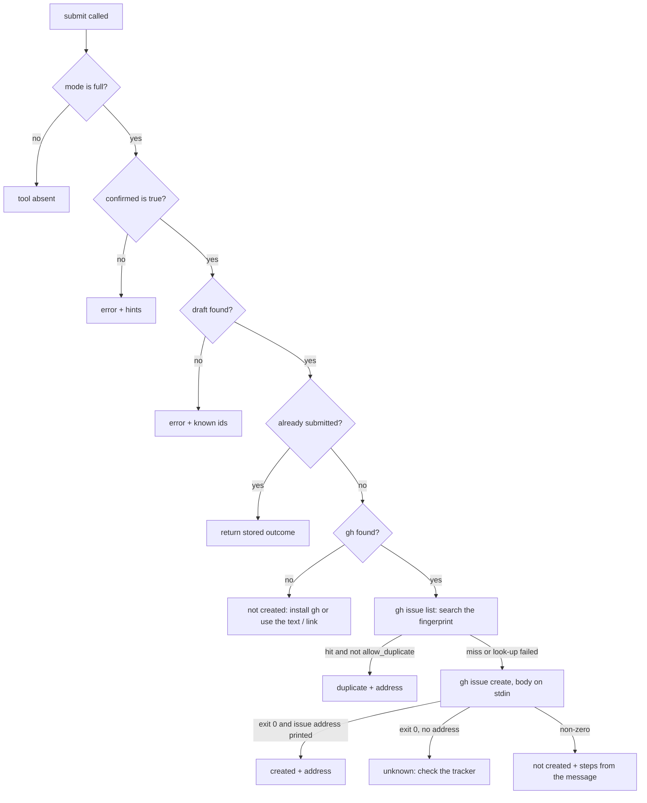

# Agent Feedback Channel (Rust)

**Version:** 1.1.0
**Status:** Stable
**Layer:** implementation
**Implements:** l1-agent-feedback.md

## Overview

The Rust realization of the agent feedback channel: three catalog tools, the in-memory journal of notes, evidence and drafts, the scrubber, the report and link builders, the fingerprint, submission through the human's signed-in GitHub command-line client, the session guidance, and the two configuration settings that control it.

## Related Specifications

- [l1-agent-feedback.md](l1-agent-feedback.md) - Parent concept.
- [l2-tool-handlers.md](l2-tool-handlers.md) - `ToolManager::call_tool`, where tool outcomes are recorded and the three tools are routed.
- [l2-rust-stdio-server.md](l2-rust-stdio-server.md) - Session loop (unknown tool requests, `initialize`) and configuration loading.
- [l2-bridge-client-rust.md](l2-bridge-client-rust.md) - Source of the bridge secret to scrub and of the editor's engine version.
- [l2-test-suite.md](l2-test-suite.md) - Where the channel's tests live.

## 1. Motivation

The channel touches the session loop, the dispatcher, the configuration, a child process and the public tracker, so a change in any of them can silently break a guarantee (a secret in a report, a submission without a draft, a stray line on standard output). This specification maps each invariant to the code that holds it and fixes the limits and external formats that tests must pin down.

## 2. Constraints & Assumptions

- No new crate dependency. The fingerprint (FNV-1a, 64 bit), percent-encoding and the scrubber are small hand-written functions; there is no regular-expression crate in the manifest and none is added.
- The tracker client is the GitHub command-line client (`gh`). It is the only child process this channel starts; it is awaited (not detached), has a time limit and `kill_on_drop`, gets a piped stdin only when it needs the body, and never inherits the server's protocol channel (MCP-1). On Windows the server's own standard handles are first marked non-inheritable, as for detached launches.
- Configuration (both follow MCP-7: an empty value means "not set"):

| Key | Flag | Values | Default |
| --- | --- | --- | --- |
| `GODOT_MCP_FEEDBACK` | `--feedback` | `off`, `draft`, `full` (case-insensitive); an unknown value logs a warning to the diagnostics channel and selects `draft` (never the wider default); an empty value is "not set" and means the default | `full` |
| `GODOT_MCP_GH_PATH` | `--gh-path` | Path of the `gh` executable; `gh` on `PATH` when unset | unset |

- Limits (constants in one place, each named in the rejection message):

| Item | Limit |
| --- | --- |
| Notes per session | 20 |
| `summary` | 120 characters |
| `details` | 2,000 characters |
| `suggestion` | 500 characters |
| `tool` | 64 characters, `[a-z0-9_]` only |
| Drafts per session | 10 |
| Evidence events | 50 distinct (same tool, kind and message count up instead of adding) |
| Evidence message | 200 characters |
| Title | 100 characters |
| Report body | 24,000 characters |
| Prefilled link | 6,000 bytes in total |
| MCP client name and version | 64 characters each |
| Environment look-ups for a draft | 5 s shared budget; what has not answered is reported as `unknown` |
| `gh` duplicate look-up / create | 20 s / 45 s |

- Assumption (forecast): the 6,000-byte link budget is below GitHub's undocumented limit with margin; it is a constant to tune after an observed 414. Runner-up: 8,000. Override: edit the constant.
- Observed convention to keep: mutexes are locked through `util::lock`, and no lock is held across an `await`.

## 4. Invariant Compliance

| L1 Invariant | Implementation |
| --- | --- |
| FB-1 Local until approved | All state sits in one `Journal` behind a mutex owned by the tool manager. No file or socket is opened by the channel. The only outward calls are the two `gh` invocations made by `godot_submit_feedback`; in `draft` and `off` modes the `gh` runner is never constructed. |
| FB-2 Submission separate, explicit, bound | `godot_submit_feedback` requires `draft_id` and `confirmed` in its schema and takes no text. The handler refuses unless `confirmed` is `true` (hints: show the complete draft to the human, get a yes, call again with `confirmed: true`). An unknown id is an error that lists the known ids. A draft's title and body are written once when it is created. Its state moves as in 5.3: the handler switches `Pending` to `Submitting` under the lock before any `await`, so a concurrent second call is refused with "submission in progress"; a call on a `Submitted` draft returns the stored outcome without touching `gh`; a guard returns the draft to `Pending` when the call is cancelled mid-way (a retry then finds an issue that was already created through the duplicate look-up). The tool is absent in `draft` and `off` modes. |
| FB-3 Fixed destination | `owner/name` is parsed once from `CARGO_PKG_REPOSITORY`; the link builder and the `--repo` argument both read it. No schema of the three tools has a property for a repository, host, address or credential (a unit test walks the schemas). |
| FB-4 Scrubbed by construction | `scrub` (5.5) runs on every note field at intake, on every evidence message at intake, on the client name and version, on the title, and once more on the assembled body (idempotent). The server gathers no file, scene or screenshot content; the environment block is built from the fixed list in 5.6. |
| FB-5 Bounded | The limits table is enforced at intake: notes, field lengths and drafts are rejected with a message naming the limit; the evidence list evicts its oldest entry; a body over its limit halves the longest note details, repeatedly, until it fits and says so in the report. |
| FB-6 Evidence apart from opinion | Report sections are built from two separate sources and carry the labels `written by the agent` and `observed by the server` (5.6). Evidence enters only through `Journal::record_outcome` and `Journal::record_unknown_tool`, never through a tool parameter. |
| FB-7 One problem per issue, duplicates not filed | `fingerprint` (5.7) is computed when the draft is built and printed in the report details. `godot_submit_feedback` runs `gh issue list` for it before `gh issue create`; a hit whose body contains the fingerprint ends the call with outcome `duplicate` unless `allow_duplicate` is `true`. A look-up failure is noted in the answer and creation proceeds. |
| FB-8 A text path always exists | The draft answer always contains the report text, and the link whenever it fits 6,000 bytes (otherwise the reason). `gh` absence or failure changes only the `delivery` lines; the draft stays `Pending` and can be submitted again. |
| FB-9 Honest outcomes | The `gh issue create` outcome is mapped by exit status and by whether stdout ends with an issue address that matches the repository (5.8): created, duplicate, not created (with recovery steps chosen from the client's message) or unknown. |
| FB-10 Guidance in, switch out | `initialize` returns an `instructions` text built for the mode (5.9); the three tool descriptions repeat the rules that matter at call time; `Config` carries the mode; the catalog is built from the mode, so `off` lists none of the three tools and `draft` lists two. The mode reaches the static catalog through a process-wide cell that the session sets once at start-up, before the catalog is first read; the tool manager holds the same mode for its handlers. |
| FB-11 Never in the way | Recording is one short synchronous section under the journal lock, run after the handler has produced its result, through `util::lock` (a poisoned lock is recovered) and without `unwrap` or `expect`; the result value is not touched. The environment look-ups of a draft run on that draft's own call and do not use shared state. A test compares the results of the same failing host tool with the channel in `full` and in `off` mode. |

## 5. Detailed Design

### 5.1 Module Map

```plaintext
src/
├── feedback.rs        scrub, fingerprint, shape, percent-encoding, link builder (pure functions)
├── journal.rs         Journal: notes, evidence, counters, drafts and their states, report builder
├── issues.rs          IssueClient: gh runner, duplicate look-up, create, outcome mapping, repository address
├── config.rs          + feedback mode, gh path
├── tools.rs           + feedback state, catalog by mode, outcome recording in call_tool
├── tools/feedback.rs  catalog entries, guidance text, note / draft / submit handlers
└── server.rs          + client info capture and instructions in initialize, unknown tool requests recorded
examples/
└── fake_gh.rs         stand-in for gh used by the tests; not built with the server
```

### 5.2 Integration Points

| Where | Change |
| --- | --- |
| `server.rs` `initialize` | Remember `clientInfo.name` and `clientInfo.version` (scrubbed, length-limited); add `instructions` for the mode. |
| `server.rs` unknown tool branch | Before answering Invalid params, record the requested name as an `unknown_tool` evidence event when it matches `[A-Za-z0-9_.-]{1,64}`, else count it under `<invalid name>`. |
| `tools.rs` `call_tool` | After argument validation fails, record `invalid_arguments`; after a handler returns an error result, record `error` with the first line of its text; count every call and failure per tool. Calls to the three feedback tools are not recorded. |
| `tools.rs` catalog | Entries for the tools allowed by the mode. |
| `bridge.rs` | Expose the secret lookup so the scrubber can replace the exact value. |
| `Cargo.toml` | Unchanged apart from the version at release time. |

### 5.3 State

[REFERENCE] Shapes the tests and the report builder rely on:

```plaintext
Note        { id: "n1".., kind, summary, details, tool?, impact?, suggestion?, drafted: bool }
Evidence    { kind: error | invalid_arguments | unknown_tool, tool, message, count, last_seen_secs }
Draft       { id: "d1".., title, body, fingerprint, link?, note_ids, state: Pending | Submitting | Submitted(Outcome) }
Outcome     { Created(address) | Duplicate(address) | NotCreated(reason, steps) | Unknown(detail) }

Draft states
  Pending     --submit, confirmed-->  Submitting
  Submitting  --Created or Unknown--> Submitted(outcome)       (stored; a repeat returns it)
  Submitting  --Duplicate or NotCreated, or call cancelled--> Pending   (retry allowed; Duplicate needs allow_duplicate)
Counters    { per tool: calls, failures }
Session     { client_name?, client_version?, started_at }
```

### 5.4 Tool Contracts

| Tool | Input rules | Answer |
| --- | --- | --- |
| `godot_note_feedback` | `kind`, `summary`, `details` required; `kind` and `impact` are enumerations checked by the schema; text fields scrubbed, then length-checked | `Noted as n3.` followed by the list of undrafted notes (id, kind, summary) |
| `godot_draft_feedback` | `note_ids` must name existing notes (drafted ones allowed), default every undrafted note; at least one note is required (otherwise the error says to record a note first); `title` optional, scrubbed, newlines replaced by spaces, shortened to 100 characters, always prefixed with `[agent-feedback]` and a space | Draft id, title, report in a fenced block, link or reason, fingerprint, `delivery` lines (copy: always; link: when it fits; submit: when mode is `full` and `gh` is found on `PATH` or at the configured path), notes left out, next-step instruction for the agent |
| `godot_submit_feedback` | `draft_id`, `confirmed` required; `allow_duplicate` optional | One of the four outcomes with address or recovery steps; always repeats that the report is now public when created |

The next-step instruction in a draft answer says, in order: show the complete report to the human in the human's language; offer copy by hand, the link, submission (only when listed as available) or discard; do not call submit without an explicit yes from the human in this conversation.

### 5.5 Scrubber

```plaintext
scrub(text, context) -> text
  1. remove control characters except newline and tab, and the bidirectional override characters
  2. replace the exact bridge secret value, when known, with {redacted}
  3. replace the project directory (when known) with {project}; only when it is known, replace
     the home directory (HOME, or USERPROFILE on Windows) with ~. Both match either separator
     style and, on Windows, ignore case; a match must not continue into a longer name. Without
     the project, a path under the home directory is left to step 4, because ~/Name/... would
     show the project's own folder name
  4. for each token delimited by whitespace, quotes, backticks or any of < > [ ] , ; | =
     (braces and parentheses are not delimiters, so {project}/a.gd stays one token)
     and not starting with res:// or user://:
       a Windows drive path, a UNC path, or a Unix absolute path with at least two segments
       or a known root (/home /Users /root /tmp /var /opt /mnt)  ->  {path}
     (trailing punctuation stays outside the replacement)
  5. replace credential-shaped runs of ASCII letters and digits with {redacted}:
       a word (letters, digits, underscores, hyphens) that starts with ghp_ gho_ ghs_ github_pat_
       sk- xoxb- xoxp- or AKIA and has at least 8 more characters, the value of 8 or more
       characters after the word Bearer, and any run of 32 or more letters and digits that
       contains both a letter and a digit
  6. neutralize Markdown for the tracker:
       "@" followed by a word character  ->  "@" + zero-width space
       "#" followed by digits            ->  "#" + zero-width space + digits
       "<" -> "&lt;", "![" -> "!\["
```

Placeholders use braces because angle brackets would be hidden by the tracker's HTML sanitizer when the report is rendered. The result of `scrub` is unchanged by a second pass. The credential rule stops at underscores, hyphens and slashes so that identifiers, UUIDs and `res://` paths stay readable; the exact bridge secret is removed by step 2 whatever its shape.

Each step is a separate function, so a unit test can pin each class alone.

### 5.6 Report and Link

Environment block, built only from: server version; the version line of the addon manifest at `<project>/addons/godot_mcp/plugin.cfg` when the project resolves (read-only, through `resolve_in_project`); engine version from the editor's `get_version` or else the engine binary, within the shared 5 s budget; `std::env::consts::OS` and `ARCH`; bridge state (`connected`, `unreachable`, or the failure class); the MCP client name and version; the feedback mode.

```plaintext
build_report(notes, evidence, env) -> body
  sections as listed in the concept (5.3 of the parent), each agent-written section headed
  "(written by the agent)" and each server-derived section "(observed by the server)"
  all agent-written text and every quoted failure message sits inside a fenced code block whose
  fence is longer than any run of backticks in the text, so it cannot forge a heading or a label
  server-observed context = for a missing_feature draft, every unknown_tool event (at most 10 names, with counts)
                            + up to 5 most recent distinct events per tool named by a chosen note
                            + the per-tool call and failure counts of the named tools
  if length(body) > 24,000: halve the longest note details (at a character boundary), repeat until it fits,
                            and add "(details shortened)"

build_link(title, body) -> link or reason
  base  = https://github.com/{owner}/{name}/issues/new
  query = title=<pct(title)> & body=<pct(body)>      (no other parameter)
  while length(link) > 6,000: cut the body at a character boundary and end it with
        "... (shortened; paste the full report from the conversation)"
  if even the title does not fit: no link, reason = "report too long for a link"
```

Percent-encoding leaves only unreserved characters (`A-Z a-z 0-9 - . _ ~`) unescaped.

### 5.7 Fingerprint

```plaintext
shape(message) = lowercase, digits -> "#", path-like tokens -> "<path>", whitespace collapsed, first 120 characters
key = kind of the draft
    + sorted tool names of the chosen notes
    + sorted shapes of the evidence reported in the draft
    + sorted names of requested-but-missing tools (missing_feature drafts only)
    + (only when the three lists above are all empty) the normalized words of the first summary
fingerprint = "gmfb" + first 12 hex digits of FNV-1a-64(key)
```

The fingerprint is one alphanumeric token so the tracker's search treats it as a single term.

### 5.8 Submission



Client contract:

| Call | Arguments | Notes |
| --- | --- | --- |
| Duplicate look-up | `issue list`, `--repo {owner}/{name}`, `--state all`, `--search`, then the single argument `{fingerprint} in:body`, `--json number,title,url,body`, `--limit 5` | A hit counts only when its body contains the fingerprint; no stdin |
| Create | `issue create`, `--repo {owner}/{name}`, `--title={title}`, `--body-file -` | The title travels as one `--title=` argument so a leading `-` cannot be read as an option (TL-5); the body is written to stdin and never to the command line; no label, assignee or other option |

Both calls run with prompts, colour and the update notice switched off through the environment (`GH_PROMPT_DISABLED=1`, `NO_COLOR=1`, `GH_NO_UPDATE_NOTIFIER=1`). A created issue is recognized by a final stdout line that starts with `https://github.com/{owner}/{name}/issues/` followed by digits. Failure hints by message: the client asks to log in or to set a token, so tell the human to run `gh auth login` in a terminal; a network or rate-limit message, so retry later; anything else, so quote the first scrubbed line. Every not-created answer also points to the text and link paths.

### 5.9 Session Guidance

`instructions` (at most 150 words) and the tool descriptions must contain these points, in the mode-appropriate form:

| Point | Requirement |
| --- | --- |
| When to note | While working, as soon as a godot-mcp tool, its message, its schema or the README blocks or misleads the task, or a needed capability has no tool |
| What not to note | The agent's own mistakes, problems in the user's project or scripts, anything not observed in this session |
| How to write | English; what was tried, what came back, what was expected; name the tool when one is involved; one problem per note |
| When to draft | When the human's request has been completed or abandoned, or when the human asks for feedback, and only when notes exist; one draft per problem |
| What to show | The complete report, in the conversation, then the offer: copy it, open the link, submit it, or discard it |
| Limit of authority | Never call submit without the human's explicit yes in this conversation; `draft` mode omits every mention of submission |

### 5.10 Test Plan

| Behaviour | File |
| --- | --- |
| Scrubber classes, Markdown neutralization, fingerprint stability, link budget, percent-encoding, evidence eviction, limits | unit tests in `src/feedback.rs` |
| Repository address parsing, outcome mapping from `gh` output | unit tests in `src/issues.rs` |
| Mode `off` / `draft` / `full` catalog shape; `initialize` carries `instructions` per mode and, in `draft` mode, never names the submit tool; unknown value of the setting falls back to `draft` with a warning on stderr only | `tests/stdio_protocol_test.rs` |
| Note intake and caps; draft content with scrubbed secret, home and project paths, mentions; evidence from a failing named tool and from an unknown tool request; environment block with the mock editor and without one; link and delivery lines | `tests/feedback_test.rs` |
| Consent gate: `confirmed` missing or false, unknown id, second submit returns the first outcome | `tests/feedback_test.rs` |
| Submission with a stand-in `gh` (`GODOT_MCP_GH_PATH`): argument vector as in 5.8 (one argument per recorded line), body on stdin equals the draft body, created, duplicate with and without `allow_duplicate`, not signed in, `gh` missing, exit 0 without an address, timeout; two concurrent submits of one draft create once; a cancelled submit leaves the draft retriable; standard output of the server stays free of `gh` output | `tests/feedback_test.rs` |
| Same failing host tool gives the same result with the channel in `full` and in `off` mode (FB-11) | `tests/feedback_test.rs` |
| The stand-in `gh`: an example target (`examples/fake_gh.rs`) that is a real executable on every platform, because the runtime refuses to start a batch file with arguments it cannot escape safely. The test helper builds it before use, every time, since a test run that names one test target does not rebuild examples. Behaviour comes from environment variables; an argument containing `FAKE_GH_SLEEP_<ms>` slows one call without touching the environment | `tests/common/mod.rs`, `examples/fake_gh.rs` |

## 6. Implementation Notes

1. Pure functions first with their unit tests: `scrub`, `shape`, `fingerprint`, `percent_encode`, `build_link`.
2. Journal and the note tool; then evidence recording in `call_tool` and the session loop.
3. Draft and report assembly, then the guidance text in `initialize` and the tool descriptions.
4. `IssueClient` and `godot_submit_feedback` against the stand-in `gh`.
5. Configuration, `.env.example`, README (tools table, a feedback section, the two settings) and an issue template for the manual path; the user-facing changelog entry belongs to the release.
6. Maintainer one-time setup, not code: create the tracker label used by the template.

## 7. Drawbacks & Alternatives

- **Parsing the client's output** (issue address on the last line) depends on `gh`'s human-readable format; the `unknown` outcome contains the damage if that format changes.
- **A regular-expression crate** would shorten the scrubber; rejected to keep the dependency list unchanged. A token-based scrubber is less exact for paths with spaces, which is acceptable because the human reviews the text.
- **Issue form templates with prefilled fields**: deferred; how field identifiers map to link parameters is not documented in the pages checked, so the link carries only title and body.
- **Calling `gh` through its web API subcommand to attach labels**: rejected for the permission reasons in the parent.

## Canonical References

| Alias | Path | Purpose |
| --- | --- | --- |
| `[SESSION]` | `src/server.rs` | `initialize`, unknown tool branch |
| `[TOOLS]` | `src/tools.rs` | Catalog, dispatch, outcome recording |
| `[CONFIG]` | `src/config.rs` | Settings |
| `[BRIDGE]` | `src/bridge.rs` | Secret lookup, engine version command |
| `[PATHS]` | `src/paths.rs` | `resolve_in_project` for the addon manifest read |
| `[ENGINE]` | `src/cli_runner.rs` | Child process conventions (time limit, `kill_on_drop`, Windows handle isolation) |
| `[HELPERS]` | `tests/common/mod.rs` | Session driver, mock editor, fake executables |
| `[MANIFEST]` | `Cargo.toml` | Repository address |

## Document History

| Version | Date | Author | Description |
| --- | --- | --- | --- |
| 1.0.0 | 2026-10-16 | Agent (magic.spec) | Created with the parent concept. |
| 1.0.1 | 2026-10-16 | Agent (magic.run) | Clarified during implementation: brace placeholders instead of angle brackets, fenced agent text, narrower credential rule, bidirectional override characters removed. |
| 1.0.2 | 2026-10-16 | Agent (magic.run) | Recorded implementation decisions: module map with the journal and the tool submodule, mode-to-catalog cell, home directory shortened only once the project is known, delimiter set of the path step, stand-in provided as an example target. |
| 1.1.0 | 2026-10-21 | Agent (magic.spec) | [MODIFIED] An unknown `GODOT_MCP_FEEDBACK` value selects `draft` instead of the default `full` (FB-10). Source: simulation QA of 2026-10-21 (Q11). Stable → RFC → Stable after Post-Update Review. |
