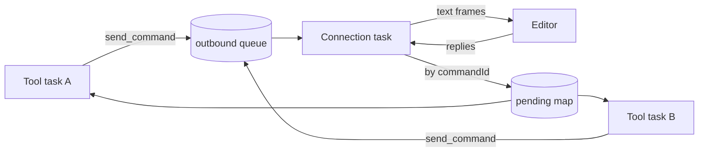

# Bridge Client (Rust)

**Version:** 1.1.0
**Status:** Stable
**Layer:** implementation
**Implements:** l1-editor-bridge.md

## Overview

The server side of the live editor bridge: a cloneable client that keeps one WebSocket connection to the editor, multiplexes concurrent commands over it by id, attaches the shared secret, classifies failures, and reconnects after an editor restart.

## Related Specifications

- [l1-editor-bridge.md](l1-editor-bridge.md) - Parent concept.
- [l2-godot-editor-addon.md](l2-godot-editor-addon.md) - The editor-side peer.
- [l2-tool-handlers.md](l2-tool-handlers.md) - Callers of `send_command`.

## 1. Motivation

Captures the timing constants and the connection state machine, which are easy to change accidentally and directly determine how fast a tool fails when no editor is running.

## 2. Constraints & Assumptions

- Client library: `tokio-tungstenite` over a `TcpStream` connected to `127.0.0.1:{port}`.
- Timing: connect 300 ms, WebSocket handshake 2 s, command reply 15 s (overridable for tests), cooldown after a failed connect 500 ms.
- Secret source order: `GODOT_MCP_TOKEN` (trimmed, non-empty), else the token file at the OS user-data directory, mirroring the editor's `OS.get_data_dir()`: `%APPDATA%` on Windows, `~/Library/Application Support` on macOS, `$XDG_DATA_HOME` or `~/.local/share` elsewhere, then `godot-mcp/bridge-{port}.token`.
- The secret is read once per connection, so a restarted editor (new secret) is picked up on reconnect.
- [ADDED] The port the client dials is `Config::debug_port`, chosen at start-up as [l2-rust-stdio-server.md](l2-rust-stdio-server.md) MCP-7 says. `bridge_port.rs` holds the derivation: the canonical project path (symlinks resolved on Unix; on Windows made absolute, without the `\\?\` prefix, with `/` separators and ASCII letters in lower case; no trailing slash), hashed with 32-bit FNV-1a over its UTF-8 bytes, modulo 20000, plus 10000. The addon computes the same value (`core/bridge_port.gd`); `tests/bridge-port-vectors.json` holds the path-to-port cases both sides check.
- [ADDED] The editor launcher passes the server's port to a launched editor as `GODOT_DEBUG_PORT`, so the editor it starts listens where the server dials.

## 4. Invariant Compliance

| L1 Invariant | Implementation |
| --- | --- |
| BR-1 Loopback only | The client only ever dials `127.0.0.1`; the listening side is enforced by the addon. |
| BR-2 Shared secret | Every `BridgeCommand` carries `token` from `read_token(port)`; the editor's "Unauthorized" reply surfaces as `ToolExecution` and gets token-specific hints in the tool layer. |
| BR-3 Exactly one reply | A `oneshot` reply slot per command; a guard removes the slot when the caller stops waiting (timeout or cancellation); on connection loss every pending slot receives a connection-closed error. |
| BR-4 Correlated commands | `commandId` is a UUID v4; a reader task delivers each reply to the slot with the same id and ignores unknown ids and malformed frames (logged). |
| BR-5 Undoable mutations | Enforced editor-side; the client sends mutations as ordinary commands. |
| BR-6 Scene confinement | Enforced editor-side. |
| BR-7 All-or-nothing updates | Enforced editor-side; the reply's `applied` map is passed through unchanged. |
| BR-8 Fast, classified failures | Connect/handshake failures → `BridgeUnavailable` and a 500 ms cooldown that fails further attempts immediately; broken connection or reply timeout → `Bridge`; `status: error` → `ToolExecution`. A dead connection is detected via an `alive` flag and replaced on the next command. [MODIFIED] The unavailable message names the port and where it came from, and says that an addon without a configured port listens on the port derived from its own project path, so a server started in that project's directory finds it, and which settings set one port on both sides. |
| BR-9 Version gate | Enforced editor-side. |
| BR-10 Editor-only | Not applicable to the server binary. |
| BR-11 Project-confined paths | Enforced editor-side; host-side paths are confined by the tool layer. |
| BR-12 Saved edits only | Enforced editor-side; `make_editable` is passed through as an ordinary parameter. [ADDED] |
| BR-13 One port per project | `bridge_port::derived_port` as in §2; the unit test `the_shared_vectors_hold_for_the_port_formula` runs the shared cases through the server's function, and `the_addon_derives_the_same_bridge_port_as_the_server` (editor end-to-end) runs them through the addon's; `an_editor_without_a_port_setting_is_found_on_the_derived_port` checks the pair end to end. [ADDED] |

## 5. Detailed Design

### 5.1 Concurrency Model

- The state lock is held only while obtaining or establishing the connection, never while waiting for a reply.
- WebSocket pings from the editor are answered with pongs by the connection task.

## 7. Drawbacks & Alternatives

- **Connection per command** was the original design; replaced because each call paid a connect and logged on the editor side.
- **Longer connect timeout**: unnecessary on loopback, where a closed port refuses immediately; the short timeout keeps offline tool calls around 300 ms instead of seconds.

## Canonical References

| Alias | Path | Purpose |
| --- | --- | --- |
| `[CLIENT]` | `src/bridge.rs` | Client, connection task, token path |
| `[TESTS]` | `tests/bridge_client_test.rs` | Multiplexing, reconnection, timeout and error-class tests |
| `[PORT]` | `src/bridge_port.rs` | Port derived from the project path |
| `[PORT-CASES]` | `tests/bridge-port-vectors.json` | Path-to-port cases shared with the addon |
| `[CONFIG]` | `src/config.rs` | Which port the client dials and its origin |

## Document History

| Version | Date | Author | Description |
| --- | --- | --- | --- |
| 1.0.0 | 2026-10-16 | Agent (magic.analyze first-time) | Reverse-engineered from the code at 94e4540. |
| 1.1.0 | 2026-11-02 | Agent (magic.spec) | Reality sync after ventilation. [ADDED] The derived port and its shared cases (BR-13, pull request 75), the port given to a launched editor, the BR-12 row; [MODIFIED] the unavailable message. Stable → RFC → Stable after Post-Update Review. |
