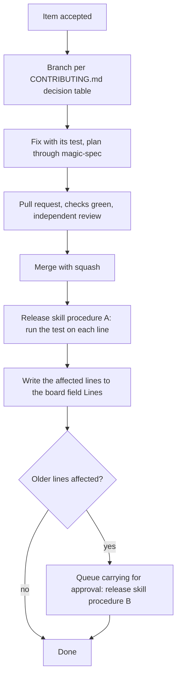

# Repo Steward for godot-mcp

**Version:** 1.0.2
**Status:** Stable
**Layer:** implementation
**Implements:** l1-repository-stewardship.md

## Overview

How the portable `repo-steward` skill ([l2-repo-steward-skill.md](l2-repo-steward-skill.md)) is installed and configured in `zeegzoog/godot-mcp`: the profile values, the labels and the board, the priority examples, how fixes are routed to and carried between the Godot release lines, how the readiness notice speaks about the lines, the installed workflows, the issue forms and the pull request template, the changes to the contributor and agent guides, the tests that guard the safety properties, and the settings a maintainer makes by hand.

## Related Specifications

- [l1-repository-stewardship.md](l1-repository-stewardship.md) - Parent concept.
- [l2-repo-steward-skill.md](l2-repo-steward-skill.md) - The skill this specification configures; every behaviour not named here is the skill's default.
- [l2-release-branches.md](l2-release-branches.md) - Branch map, line tags, `.github/lines`, the uncarried-change check and the release procedures the steward follows and points to.
- [l2-community-health-files.md](l2-community-health-files.md) - The contributor guide section and the issue chooser this installation adds to.
- [l2-test-suite.md](l2-test-suite.md) - Where the steward's tests live.
- [l2-agent-feedback-rust.md](l2-agent-feedback-rust.md) - §5.7: the fingerprint that agent reports carry.

## 1. Motivation

The skill is generic by design; this repository has facts it must be told: four lines released together from four branches, a planning engine that exists only on the maintainer's machine, agent reports with a fingerprint, a contributor guide that already fixes routing, checks and conventions, and a backlog of outside pull requests waiting on run approvals. This specification records those facts once, so the profile, the workflows and the guides agree.

## 2. Constraints & Assumptions

- Facts checked on 2026-10-20 with `gh`:
  - `zeegzoog/godot-mcp` is public and owned by the organization `zeegzoog`; the maintainer's account has `ADMIN` permission and a token with `repo`, `project` and `workflow` scopes.
  - Issues and Projects are enabled; Discussions are not; the organization has no project.
  - `master` has no branch protection; the history is linear (no merge commits among 55); squash, merge and rebase merges are allowed; head branches are not deleted after merge.
  - The default workflow token is read-only; no secrets and no variables exist; the private vulnerability reporting form is enabled.
  - Labels: GitHub's defaults and `agent-feedback`.
  - Open items: issue #1 (an agent report, no label, no reply) and pull requests #2–#8 from one contributor's fork, all allowing maintainer edits; their CI runs wait for approval; #4, #5 and #6 share their first two commits; #2 declares that it closes #1.
- The planning engine (`.magic/`, the `magic.*` workflow files) is git-ignored, while `.design/` is committed: on a CI runner the ecosystem is used but not available, so unattended runs make no code change (ST-7).
- Every skill directory is git-ignored except listed exceptions. The rule must name the directory's contents (`/.*/skills/*`): with `/.*/skills/` git excludes the directory itself and no `!` exception can re-include a skill (found while installing; the release skill was tracked only because it had been added by force).
- Blank issues stay enabled: the agent feedback link opens `issues/new` with a title and a body only, and an issue chooser that forces a form would drop them.
- The release skill requires a person's approval for every push or tag it makes, so carrying a change to a release line is queued for approval.
- **Assumption (forecast):** the board is public, owned by the organization and named "godot-mcp issues and pull requests", because the issues it shows are public anyway and contributors can then see where their item stands. Runner-up: a private board. Override: `board.public: false` in `.github/steward.yml`.
- [DR] Merge method squash, with a Conventional Commit subject: it keeps the history linear as it has been, and one pull request becomes one carryable commit for `git cherry-pick -x`.

## 4. Invariant Compliance

| L1 Invariant | Implementation |
| --- | --- |
| ST-1 Current repository only | Skill default; the working copy's `origin` is `zeegzoog/godot-mcp`, and the workflows run with `GITHUB_REPOSITORY`. |
| ST-2 Portable procedure, project facts from the project | Guides `AGENTS.md CONTRIBUTING.md SECURITY.md` (no `CLAUDE.md` exists); the profile of §5.2. `CONTRIBUTING.md` owns routing (Branches and Godot Versions), checks (Verification) and conventions (Commits and Pull Requests); the profile does not repeat them. |
| ST-3 Content is data | Skill default. `review.sensitive_paths` adds `build.rs` and `.cargo/` to `.github/`, the places where a contributor's change runs code during the build. |
| ST-4 Every open item triaged | Fingerprint pattern `gmfb[0-9a-f]{12}` (the report line `Fingerprint: …`); priority examples in §5.4; the bug form (§5.8) asks for the godot-mcp version, the Godot version, the OS and the MCP client. An agent report is typed by the kind in its title when the title has one (`bug`, `missing_feature` → `enhancement`, `improvement` → `enhancement`, `docs` → `documentation`), otherwise by its content, and keeps its `agent-feedback` label. |
| ST-5 Security reports kept private | The redirect links `SECURITY.md` and `https://github.com/zeegzoog/godot-mcp/security/advisories/new`. |
| ST-6 Pulled in priority order under a WIP limit | WIP In Progress 2, In Review 3. |
| ST-7 Changes made the project's way | `planning.ecosystem` stays `auto`; detection finds the `magic-spec` adapter (planning directory committed, engine installed locally), so an accepted item goes to `/magic.spec` as raw input with its link, and `/magic.task` and `/magic.run` follow; its planning path is also what readiness ignores. Planning commits are separate from product commits. With the planning files removed from the repository the profile stays valid and the steward falls back to plan messages. Fix branch from the branch `CONTRIBUTING.md` routes to (usually `master`); the verification of `CONTRIBUTING.md` § Verification, including the editor tests with the line's Godot build whenever `addons/godot_mcp/` changes. Carrying: §5.5. |
| ST-8 Independent review before merge | Skill default; the reviewer also checks the completion checklist of `AGENTS.md`. Checks green means every job of `ci.yml` (three Rust jobs and the Godot job) finished successfully on the head commit. |
| ST-9 Change requests decided on their merits | Review checklist adds: the target branch per the decision table of `CONTRIBUTING.md`; no change to version strings or `CHANGELOG.md` sections; no reference to `.design/`, task ids or specification names in product files; a pull request that adds tools maps to the roadmap concepts it implements, and while those concepts are parked on undecided questions, accepting it is a maintainer decision. A pull request opened before the line split targets an outdated `master`: it is updated, or its author is asked to rebase. |
| ST-10 Autonomy by action class | Skill defaults (§5.2): `merge_external: approval`. The maintainer of record approves in an attended run or with `/steward approve` on the item. |
| ST-11 Disclosed, brief, businesslike voice | Language English, the language `CONTRIBUTING.md` prescribes for code, commit messages and documentation. |
| ST-12 Closure states the outcome | A fix merged to `master` closes its issue as completed through its closing keyword; the fixed message says it ships in the next release, which contains every Godot line. A fix that exists only on a `godot-v*` branch is closed by the steward, since closing keywords act only on `master`. The released message names the release `vX.Y.Z` and the files ending in `-godotM.N` for the reporter's Godot version. |
| ST-13 Conversation answered, disputes handed over | Skill defaults. |
| ST-14 Idempotent, bounded, loop-free | Skill defaults; allowed bots: `dependabot[bot]` (no dependency bot is configured yet). |
| ST-15 One flow board, explicit policies | Board "godot-mcp issues and pull requests" owned by `zeegzoog`, public, linked to the repository; extra text field `Lines` (the Godot lines an item affects, for example `4.8 4.7 4.6`). |
| ST-16 Maintainer decisions win | Skill defaults. |
| ST-17 Readiness notice, never a release | §5.6. The notice points to the release skill, procedure C; DS-7 keeps every tag behind a person's approval. |
| ST-18 Accountable runs | Skill defaults; the first run after installation is a report run (§6). |

## 5. Detailed Design

### 5.1 Files

```plaintext
.agents/skills/repo-steward/              the portable skill (l2-repo-steward-skill.md §5.1)
.github/steward.yml                       profile (§5.2)
.github/steward-priorities.md             priority examples (§5.4), named by triage.priority_examples
.github/workflows/steward-stale.yml       installed from the skill templates
.github/workflows/steward-readiness.yml   installed from the skill templates
.github/workflows/steward-agent.yml       installed; does nothing until STEWARD_AGENT is on
.github/ISSUE_TEMPLATE/bug_report.yml     issue form (§5.8)
.github/ISSUE_TEMPLATE/feature_request.yml
.github/ISSUE_TEMPLATE/config.yml         unchanged: blank issues enabled, security contact link
.github/pull_request_template.md          the description CONTRIBUTING.md asks for (§5.8)
.gitignore                                skill rule /.*/skills/* with the exception !/.agents/skills/repo-steward
CONTRIBUTING.md                           section Issues and Pull Requests; For AI Agents exception (§5.9)
AGENTS.md                                 pointer to the skill for issue and pull request work (§5.9)
tests/steward_test.rs                     safety and readiness tests (§5.10)
```

### 5.2 Profile Values

Keys that differ from the skill defaults:

| Key | Value |
| --- | --- |
| `project.guides` | `AGENTS.md CONTRIBUTING.md SECURITY.md` |
| `board.title` | `godot-mcp issues and pull requests` |
| `board.text_fields` | `Lines` |
| `triage.priority_examples` | `.github/steward-priorities.md` |
| `review.sensitive_paths` | `.github/ build.rs .cargo/` |
| `limits.allowed_bots` | `dependabot[bot]` |
| `release.procedure` | `.agents/skills/release/SKILL.md, procedure C` |
| `release.skip_subjects` | `chore(release) chore(line)` |
| `release.targets_file` | `.github/lines` |
| `release.target_branch` | `godot-v{t}` |
| `release.target_tag` | `v{version}+godot.{t}` |
| `release.target_build_file` | `.github/godot-version` |

### 5.3 Labels Added

`priority: P0` … `priority: P3`, `status: needs-info`, `status: stale`, `status: blocked`, `status: needs-maintainer`, `steward: skip`, `release-readiness`. The existing `bug`, `enhancement`, `documentation`, `question`, `duplicate`, `invalid`, `wontfix` and `agent-feedback` are reused unchanged.

### 5.4 Priority Examples

| Priority | godot-mcp examples |
| --- | --- |
| P0 | the editor bridge accepts a command without its token or from another machine; a tool writes or reads outside the project; a release file is missing or does not start; CI fails on `master` or a `godot-v*` branch |
| P1 | a tool always fails on a supported Godot line; an editor mutation cannot be undone; the server hangs a client session |
| P2 | a stale result until the editor restarts (issue #1); an error message without a recovery step; a requested tool that fits the roadmap |
| P3 | wording of a message or the documentation; questions about usage |

### 5.5 Routing and Carrying



The approval for carrying lists every line and the commit to carry, in one consent question in an attended run, or as `status: needs-maintainer` with the list in the run report of an unattended one. RL-7 is still checked by the release procedure itself; the steward's record makes that check short.

### 5.6 Readiness for the Godot Lines

`readiness.sh` with the profile of §5.2 reads the lines from `.github/lines` on `master` (4.5, 4.6 and 4.7 on 2026-10-20), the branch `godot-vM.N` and the Godot build from that branch's `.github/godot-version`, and the line's own commits since its line tag `vX.Y.Z+godot.M.N`. `master` is the development line and is not a target. The last release is the highest plain tag `vX.Y.Z` (v0.5.1).

```plaintext
[REFERENCE] notice body, state due
Recommendation  A release is due: v0.6.0 (minor) — 1 feature, 2 fixes; the oldest change is 23 days old.
User-facing changes
  feat(tools): reload an open scene when its file changes (#2, closes #1)
  ...
Release targets  every release contains every line
  Godot 4.7  godot-v4.7  verified against 4.7.2-stable  own changes: none
  Godot 4.6  godot-v4.6  verified against 4.6.3-stable  own changes: fix(bridge): ... (abc1234)
  Godot 4.5  godot-v4.5  verified against 4.5.2-stable  own changes: none
  Godot 4.8 (development, master) is not released.
How to release   Ask your agent to "release v0.6.0" (.agents/skills/release/SKILL.md, procedure C).
                 It runs the checks on every line with that line's Godot build, lists the changes not
                 carried to each line, and stops for your approval before any tag is pushed.
Not counted      5 internal commits (docs, ci, test, refactor)
```

### 5.7 Installed Workflows

The three templates of the skill with the profile values. `steward-agent.yml` additionally sets `--max-turns` to bound one run, and its prompt names the skill path `.agents/skills/repo-steward/SKILL.md`. `steward-readiness.yml` triggers on pushes to `master` only.

### 5.8 Issue Forms and Pull Request Template

| File | Fields |
| --- | --- |
| `bug_report.yml` (label `bug`) | godot-mcp version (from `plugin.cfg`), Godot version, operating system, MCP client, steps, expected, actual, server log (optional, `RUST_LOG=godot_mcp=debug`); a reminder that vulnerabilities go to `SECURITY.md` |
| `feature_request.yml` (label `enhancement`) | the problem, the proposed behaviour, alternatives, which Godot versions it concerns |
| `pull_request_template.md` | what changed and why; which Godot lines it affects and how that was checked; the checks of § Verification that were run; `Fixes #` line |

Forms only add choices: blank issues and the agent feedback template stay.

### 5.9 Guide Changes

- `CONTRIBUTING.md` § Issues and Pull Requests (after § Commits and Pull Requests): an AI assistant triages, answers and reviews on behalf of the maintainers and says so in every message; the labels and priorities; a request for information is closed after 14 + 7 days without a reply and can be reopened; how to reach a person (ask for a maintainer in a comment); the maintainers decide on accepting features and on releases; the board link.
- `CONTRIBUTING.md` § For AI Agents: the bullet "Never push, tag or publish a release without the explicit approval of your user" gains "— except the actions the repo-steward skill's autonomy settings allow (its defaults, as adjusted in `.github/steward.yml`)"; tagging and publishing a release are never among them.
- `AGENTS.md`: in its introduction, next to the pointer to `CONTRIBUTING.md`, one sentence — issue and pull request work follows `.agents/skills/repo-steward/SKILL.md`, whose autonomy settings bound what an agent posts, closes or merges without asking. (Tool Invocation Protocols is about using godot-mcp in a Godot project, not about this repository.)

### 5.10 Tests

`tests/steward_test.rs` (default test run; a test that needs `bash` or `git` prints why and returns early when the tool is missing). Like every product file it names no planning artifact:

| Test | Proves |
| --- | --- |
| readiness on a fixture repository | `readiness.sh` classifies Conventional Commits, ignores release commits and commits that touch only `release.ignore_paths` (the fixture sets its own path), computes state and version, and lists the targets with their builds |
| stale workflow and profile agree | the label the reminder workflow watches equals the profile's needs-info label |
| agent workflow least privilege | `steward-agent.yml` is gated on `vars.STEWARD_AGENT`, has no `contents: write`, no `pull_request_target`, and no checkout of a pull request ref |
| no event trigger for the agent | `steward-agent.yml` triggers only on `schedule` and `workflow_dispatch` |
| skill directory is tracked | `git check-ignore` does not ignore `.agents/skills/repo-steward/SKILL.md` |
| tokens out of the agent's reach | the agent step has no `STEWARD_PROJECT_TOKEN`, no raw `gh api`, no broad `gh issue`/`gh pr`, no `--body-file`, and is denied `/proc`; the checkout does not persist credentials |
| third-party actions pinned | every non-GitHub action in the steward workflows is pinned to a full commit SHA |
| messages are disclosed and secret-free | `act.sh` refuses a message without disclosure and marker, one with a token, and a non-numeric item |
| board queue is checked | `board.sh` with `STEWARD_BOARD_QUEUE` queues a valid change and refuses another repository, unknown options and fields, and bad dates |
| no way to write or run the agent's own files | the agent step has no `git` command and no wildcard over the scripts; a step before it makes `.agents` read-only |
| branch names are not options | `readiness.sh --default-branch --output=<file>` is refused and writes no file |
| release lookup takes a commit id only | `api.sh released-in` refuses options, ref names, shell characters and short ids |

### 5.11 Maintainer Setup

| Step | Where |
| --- | --- |
| Column limits on the Flow view: In Progress 2, In Review 3 | Project → Flow → column menu → Set limit |
| Built-in workflows: Item closed → Done; Pull request merged → Done; Item reopened → Triage; Auto-archive closed items after 14 days | Project → ⋯ → Workflows |
| Automatically delete head branches | Settings → General → Pull Requests |
| Ruleset for `master`: block force pushes and deletion; require the checks `Rust (ubuntu-24.04)`, `Rust (windows-latest)`, `Rust (macos-latest)`, `Godot addon (headless editor)` for pull requests; maintainers may bypass, because release commits are pushed directly | Settings → Rules → Rulesets |
| Unattended AI run (optional): secret `ANTHROPIC_API_KEY` or `CLAUDE_CODE_OAUTH_TOKEN`, variable `STEWARD_AGENT=on`; optional `STEWARD_PROJECT_TOKEN` for board updates from CI | Settings → Secrets and variables → Actions |
| Keep "Require approval for first-time contributors" for fork runs; the steward approves runs outside the sensitive paths | Settings → Actions → General |

The branch protection for `godot-v*` stays as [l2-release-branches.md](l2-release-branches.md) §5.8 defines it.

## 6. Implementation Notes

1. The skill (its own implementation notes), with `tests/steward_test.rs` written first.
2. Install in this repository: profile, priorities file, workflows, issue forms, pull request template, `.gitignore` exception, guide changes; the full verification of `CONTRIBUTING.md`.
3. Stop for approval: pushing to `master` (CONTRIBUTING § For AI Agents).
4. `setup` against GitHub — labels and the board are outward actions; then the manual steps of §5.11 for the maintainer.
5. First run in report mode over the open items; an acting run only after the maintainer has read that report.

## 7. Drawbacks & Alternatives

- **Carrying without approval:** faster lines, but the release skill's push rule would then have two meanings; queued carrying keeps one rule.
- **A `line:` label per Godot line:** filterable, but every cut and retirement would edit labels on many items; the `Lines` board field carries the same fact without label churn (as [l2-release-branches.md](l2-release-branches.md) §7 rejected per-line labels for carrying).
- **Disabling blank issues to force the forms:** cleaner reports, but breaks the agent feedback link; rejected.
- **Running the unattended agent on every push:** fresher board, but the cost grows with commit volume; daily is enough for a single-maintainer project.

## Canonical References

| Alias | Path | Purpose |
| --- | --- | --- |
| `[CONTRIBUTING]` | `CONTRIBUTING.md` | Routing, checks, conventions; gains the handling section |
| `[AGENTS]` | `AGENTS.md` | Standards and completion checklist; gains the skill pointer |
| `[LINES]` | `.github/lines` | Lines every release contains |
| `[LINE]` | `.github/godot-version` | Godot build per line, read from each branch |
| `[RELEASE-SKILL]` | `.agents/skills/release/SKILL.md` | Procedures A, B and C the steward follows or points to |
| `[CI]` | `.github/workflows/ci.yml` | The checks a merge waits for |
| `[CHOOSER]` | `.github/ISSUE_TEMPLATE/config.yml` | Issue chooser kept with blank issues enabled |
| `[IGNORE]` | `.gitignore` | Skill directory exception |

## Document History

| Version | Date | Author | Description |
| --- | --- | --- | --- |
| 1.0.0 | 2026-10-20 | Agent (magic.spec) | Created with the stewardship concept: profile values, labels, board, priority examples, routing and carrying across the Godot lines, readiness for the lines, workflows, forms, guide changes, tests and maintainer setup. Promoted to Stable after Post-Update Review. |
| 1.0.1 | 2026-10-20 | Agent (magic.run) | [MODIFIED] The skills ignore rule names the directory contents so that exceptions work, and the exception names only the canonical copy so a local agent link stays ignored; the `AGENTS.md` pointer sits in its introduction. |
| 1.0.2 | 2026-10-20 | Agent (magic.run) | [ADDED] Seven tests for the hardened agent workflow, the message checks, the board queue and the script arguments. |
